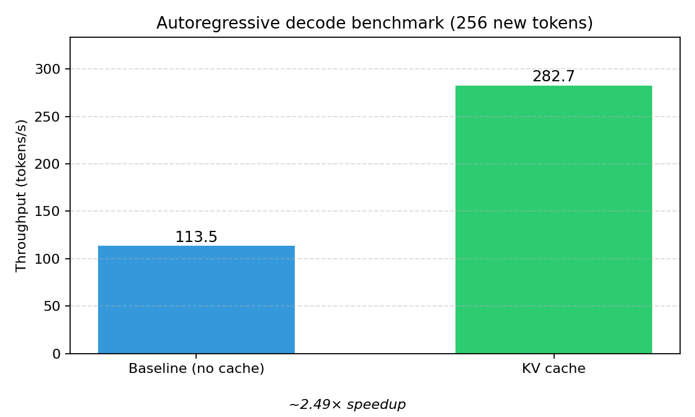
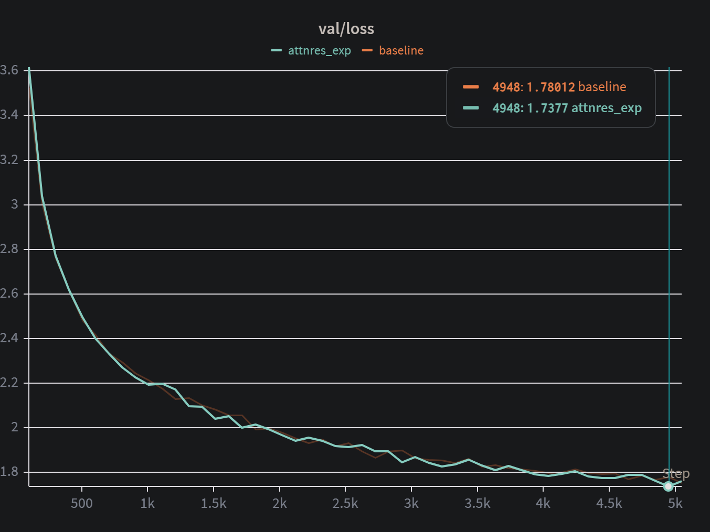
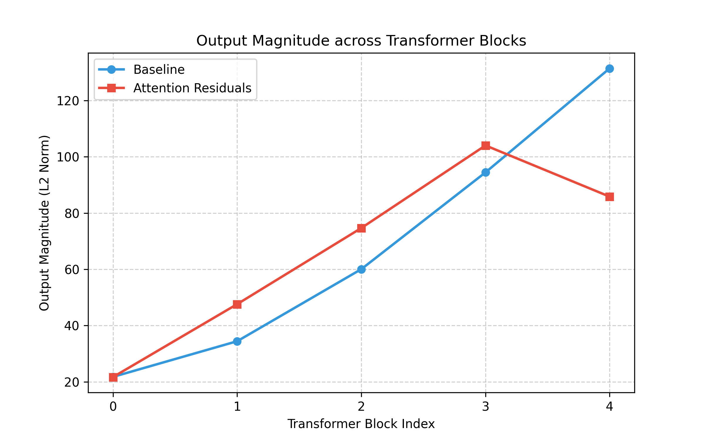

# 从零实现的 Decoder-Only Transformer 语言模型

[](https://www.python.org/downloads/)
[](https://pytorch.org/)

这是一个基于 Stanford CS336 Assignment 1 延伸完成的 **research-style 项目**：使用 PyTorch **从零实现**一个 decoder-only Transformer language model（不依赖 `nn.Transformer`），在 **TinyStories** 上完成训练，并进一步扩展了：

- **KV-cache 解码优化**
- 小规模 **Attention Residuals** 架构复现和消融实验
---

## 项目亮点

- 从零实现完整的 decoder-only Transformer 训练与推理栈
- 手写实现 attention、RoPE、RMSNorm、SwiGLU、AdamW、学习率调度、checkpoint 等核心模块
- 在 TinyStories 上训练得到可用 baseline，并生成连贯英文文本
- 实现 KV-cache 解码，在 benchmark 中获得约 **2.5×** 的生成速度提升
- 实现 AttnRes-lite，并与 baseline 进行 loss 曲线和中间表示幅值分析

---

## 核心结果

### 1. KV Cache 显著提升生成速度



在同一 checkpoint、相同 prompt 和生成长度下，KV-cache decoding 相比 baseline decoding 获得了约 **2.5×** 的吞吐提升。

| 模式 | 生成速度 |
|------|----------|
| Baseline（无 cache） | ~113 tokens/s |
| KV cache | ~283 tokens/s |
| **速度提升** | **约 2.5×** |

---

### 2. AttnRes-lite 与 Baseline 训练曲线对比



在当前 4-layer TinyStories 设定下，AttnRes-lite 训练稳定，loss 曲线与 baseline 接近，在部分阶段略优。

---

### 3. Block 输出幅值分析



相比 baseline，AttnRes-lite 在深层 block 上表现出更受控制的输出幅值增长，和 Attention Residuals 论文中的动机一致：减缓 residual stream 随深度累积放大的现象。

---

## 仓库结构

```text
CS336-assignment1/
├── assignment1-basics/          # 主体项目目录
│   ├── Transformer_lm/          # baseline / kv-cache / attnres 版本
│   ├── transformer_blk_module/
│   ├── multi_head_attn_module/
│   ├── training_loop/
│   ├── generation/
│   ├── tokenizer/, BPE/
│   ├── tests/
│   └── benchmark_generate.py
├── docs/                        # 中文实验记录、图表、日志
├── pkl_to_npy.py
└── README.md
```

实现内容

Baseline Transformer

从零实现以下模块：

Linear
Embedding
RMSNorm
SwiGLU / FFN
RoPE
scaled dot-product attention
causal multi-head self-attention
TransformerBlock
TransformerLM

训练基础设施

cross_entropy
AdamW
cosine learning rate schedule
gradient clipping
batch sampling / memmap data loading
checkpoint save / load
W&B logging

扩展实验

KV-cache decoding
AttnRes-lite（depth-wise residual routing）

环境配置

项目主要代码位于 assignment1-basics/。

```bash
cd assignment1-basics
uv sync
```

运行测试：

```bash
uv run pytest tests/
```

数据准备（TinyStories）

训练脚本默认读取 assignment1-basics/data/ 下的 tokenized 数据，例如：

data/tokenids_tinys_train.npy
data/tokenids_tinys_valid.npy

注意：训练集和验证集必须共享同一套 vocabulary 和 BPE merges，否则验证集 loss 不具有可比性。

训练

在 assignment1-basics/ 下运行：

Baseline

```bash
CUDA_VISIBLE_DEVICES=0 uv run python training_loop/training_loop.py --exp_name baseline
```

AttnRes-lite

```bash
CUDA_VISIBLE_DEVICES=0 uv run python training_loop/training_loop_attnres.py --exp_name attnres_v1
```

默认实验配置大致为：

4 layers
d_model = 512
num_heads = 16
d_ff = 1344
context_length = 256

文本生成

Baseline generation

```bash
uv run python generation/test_generate.py
```

KV-cache generation / benchmark

```bash
uv run python benchmark_generate.py
```

示例生成结果

Prompt

```text
Once upon a time
```

Model output

```text
Once upon a time, there was a little girl named Lily. She loved to play outside in the park...
```

实验总结

Baseline

在 TinyStories 上稳定训练
loss 正常下降
能生成连贯英文文本

KV Cache

支持 prefill + decode 两阶段推理
在 benchmark 中生成吞吐提升约 2.5×

AttnRes-lite

训练稳定
与 baseline loss 曲线接近
在 block 输出幅值上表现出更受控的深层增长

项目记录

更详细的中文实验记录和阶段性总结见：

docs/CS336项目概况1.md
docs/CS336项目概况2.md
docs/kv cache测试.md

说明

本项目基于 CS336 Assignment 1 的要求完成基础实现，并在此基础上加入了个人扩展实验（KV cache 与 AttnRes-lite）。课程原始材料归属 CS336，本仓库主要反映个人实现、调试与实验过程。
