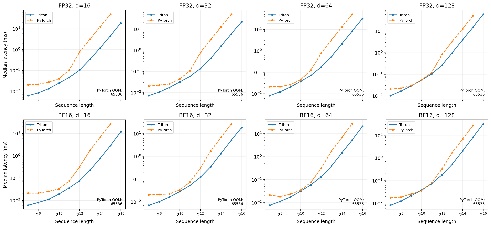
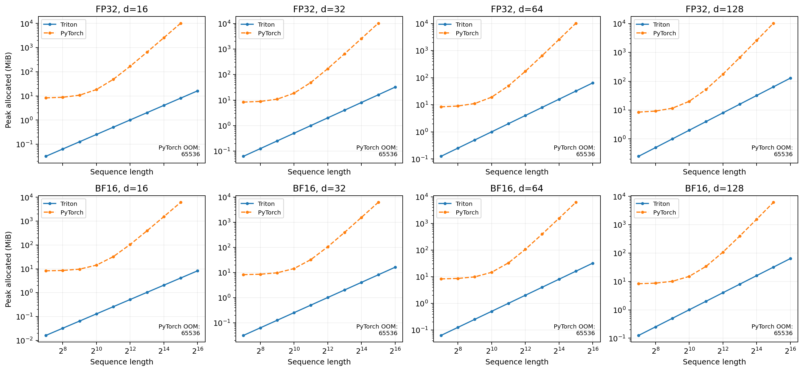

# 从零实现 Transformer 与 GPU 注意力优化

基于 Stanford CS336 的个人实现与实验项目：从 byte-level BPE、Decoder-only Transformer、AdamW 和训练循环，扩展到 KV-cache 解码、Attention Residuals 小规模对照，以及 Triton FlashAttention-2 前向、性能分析与显存测量。

A1 的原有实现与扩展保留在 `assignment1-basics/`。2026 版实现位于 `assignment1-basics-2026/`，A2 使用这份模型作为本地依赖。两个版本独立记录，避免覆盖已有 KV-cache / AttnRes 工作。

## 已完成工作

- A1：BPE tokenizer、causal attention、RoPE、RMSNorm、SwiGLU、AdamW、学习率调度、数据加载、checkpoint 与训练循环；TinyStories 与 OpenWebText 训练、文本生成及模型消融。
- 原有扩展：KV-cache 解码与 Attention Residuals（AttnRes-lite）小规模实现及对照。
- A2：CUDA 同步计时、预热实验、Nsight Systems/NVTX 分阶段分析、FP32/BF16 混合精度、显存快照、激活 checkpointing、`torch.compile` 对照。
- FlashAttention：PyTorch 分块参考、Triton 融合前向、在线 softmax、因果掩码、FP32 累计与 logsumexp 保存；通过 PyTorch 重算实现自定义 backward，并提供 `torch.compile` 路径。
- 单头注意力前向扫描：10 档序列长度 × 4 档维度 × 2 种张量精度，对比显式 PyTorch 注意力，共 160 条记录（152 成功，8 条 OOM）。

当前 Triton kernel 用于独立算子测试与 benchmark，尚未替换完整语言模型的 attention。反向不是 Triton kernel。A2 的 DDP、optimizer sharding、FSDP 和并行分析暂缓；本项目不宣称完成全部课程要求。

## 关键结果

### TinyStories 与 OpenWebText 训练

已在两种语料上完成训练。OpenWebText 运行记录达到第 5,000 步，累计处理 40,960,000 token；最后一次固定验证 batch 评估 loss 为 4.7502。这个数值来自固定 4 个验证 batch，不能描述为整个验证集的平均 loss。

[OWT 训练记录](assignment1-basics-2026/docs/OWT_EXPERIMENTS.md) · [实际指标](assignment1-basics-2026/data/lm_runs/owt-train-20260930-100005-189325/metrics.jsonl)

### Triton FlashAttention 前向

设备：RTX 4090 24 GB；PyTorch 2.11.0+cu128；Triton 3.6.0。batch=1、单头、causal，直接使用 FP32/BF16 张量输入，不启用 autocast。基线显式计算 QKᵀ、softmax 与 PV，不使用 PyTorch SDPA、官方 FlashAttention 或 `torch.compile`。

| 条件 | PyTorch 前向 | Triton 前向 | 加速比 | PyTorch 峰值 | Triton 峰值 |
|---|---:|---:|---:|---:|---:|
| BF16，S=32768，d=64 | 27.022 ms | 5.270 ms | 5.13× | 6168.375 MiB | 16.125 MiB |
| FP32，S=32768，d=64 | 51.737 ms | 8.370 ms | 6.18× | 10280.375 MiB | 32.125 MiB |
| BF16，S=65536，d=128 | OOM | 32.373 ms | — | OOM | 64.250 MiB |

表中时间是 `triton.testing.do_bench` 的中位数，预热/JIT 与随机输入构造不计入计时。显存是独立测量的 `max_memory_allocated()`，包含当时活跃的输入、输出、保存项与临时张量；PyTorch 基线还包含预生成的完整因果掩码。它不是整张卡的显存使用量。

S=65536 时，Triton 在 d=16/32/64/128、FP32/BF16 的 8 个配置全部完成，显式 PyTorch 基线全部 OOM。短序列并非每个配置都更快。FP32 指输入张量类型，这组点积允许 TF32。





[完整条件、误差检查与解释](assignment2-systems/docs/flash_forward_sweep_report.md) · [80 行对照表](assignment2-systems/outputs/flash_attention/forward_sweep/summary.csv) · [160 条测量记录](assignment2-systems/outputs/flash_attention/forward_sweep/benchmark.csv)

### torch.compile 与模型训练

独立实验：medium Transformer，24 层、d_model=1024、d_ff=4096、16 heads、词表 10000、batch=4、S=512，FP32、TF32 关闭，仅编译模型，loss 和自写 AdamW 未编译。

| 指标 | eager | compiled | 变化 |
|---|---:|---:|---:|
| 完整训练 step 平均时间 | 277.636 ms | 198.096 ms | 1.40× 加速 |
| 完整训练峰值 allocated | 13.730 GiB | 11.844 GiB | 下降 13.7% |

此组使用普通注意力，不是 Triton FlashAttention 接入模型后的端到端收益。两个实验的加速比不能相乘。输出、loss 和梯度通过已记录的数值一致性检查。

[torch.compile 报告](assignment2-systems/docs/torch_compile_report.md)

### 原有 KV-cache 与 Attention Residuals 扩展

同一 checkpoint、prompt 与生成长度下，原有 KV-cache 实验报告生成吞吐约 113 → 283 tokens/s（约 2.5×）；本次发布保留原有代码与记录，没有重测这个结果。


Attention Residuals 为小规模 AttnRes-lite 实现，4-layer TinyStories 对照中 loss 与 baseline 接近，并记录 block 输出幅值；不据此声称大模型上的质量提升。

[KV-cache 原始记录](docs/kv%20cache测试.md) · [原有项目记录](docs/CS336项目概况2.md)

## 代码与实验入口

| 目录 | 内容 |
|---|---|
| `assignment1-basics/` | 原有 A1、KV-cache 与 AttnRes 实现 |
| `assignment1-basics-2026/` | 当前 BPE、Transformer、训练工具及 A1 测试 |
| `assignment2-systems/cs336_systems/` | 自写 FlashAttention、benchmark 与 profiling harness |
| `assignment2-systems/tests/` | 官方测试与适配入口；未实现的分布式部分仍保留 TODO |
| `assignment2-systems/docs/` | 计时、混合精度、显存、checkpointing、compile 与 FlashAttention 报告 |
| `assignment2-systems/outputs/` | 较小的表格、原始样本、校验、日志和图表 |
| `docs/publication/` | 发布说明、源码清单与本次检查记录 |

A2 测试与运行使用 Python 3.12 / PyTorch 2.11。Mac 上能做 PyTorch 参考与报告整理，CUDA/Triton 和 Nsight 采集需要 Linux/NVIDIA。原有 A1 使用自己的依赖文件。

```bash
cd assignment2-systems
uv sync --frozen --python 3.12
uv run pytest tests/test_attention.py
```

当前测试适配器会在收集时导入 Triton，因此 attention 测试在没有 Triton 的 Mac 上无法收集，应在 Linux/CUDA 环境运行。历史 GPU 测试日志随结果保留，本次打包检查单独记录。

在 Linux/NVIDIA 环境重新执行完整前向扫描（会包含长序列/OOM 探测）：

```bash
uv run python -m cs336_systems.benchmark_flash_forward
```

只用已有记录重新生成前向图表与报告：

```bash
uv run python report_flash_forward.py
```

## 完整分析工件

较大的 Nsight trace、SQLite、逐事件 CSV 与显存 `.pickle` 快照放在 [A2 实验工件 Release](https://github.com/LitzGymrat/CS336-LLM_from_scratch-assginment1/releases/tag/a2-systems-20261012)。下载并在仓库根目录解压 `cs336-a2-raw-results-20261012.zip`，可恢复全部 `assignment2-systems/outputs/` 工件。报告中对应的大文件链接随后可直接打开。

[发布说明和校验](docs/publication/README.md)记录工件边界和源码哈希。训练模型权重与完整训练语料没有提交到 Git；现有训练元数据、指标和源码记录按文件大小保留。所有性能结果均为上述硬件和具体输入上的实验，未作端侧设备实测。

课程手册、官方起始代码与测试归属 Stanford CS336；项目中的个人实现、调试和实验记录分别保留来源与验证范围。
