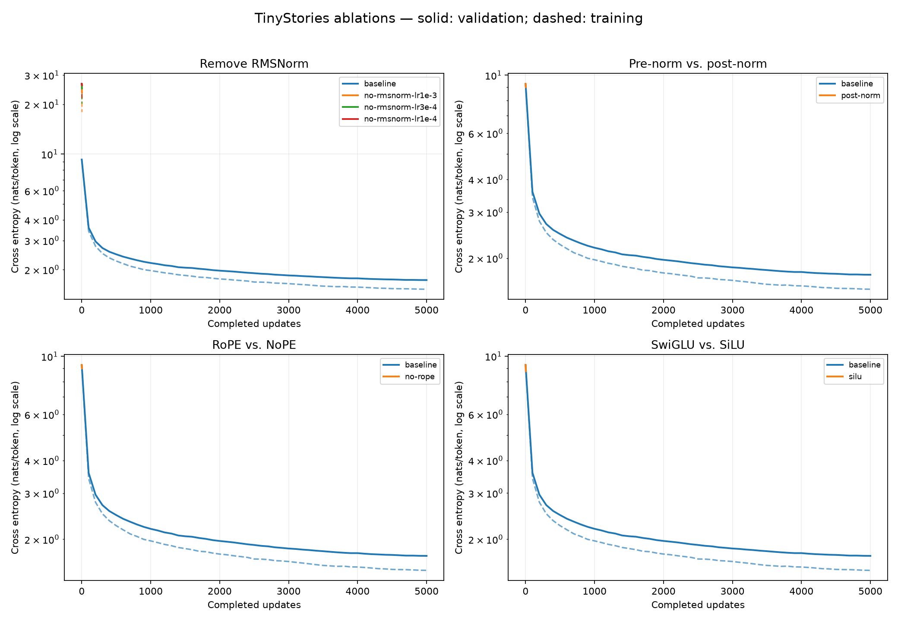
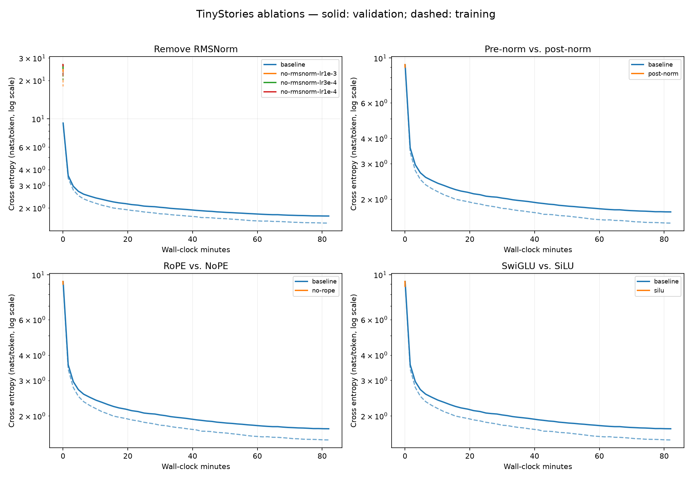

# TinyStories 消融队列结果

队列状态：`finished`。本文件在每组结束后自动更新。

正式基线验证损失 **1.7280**。下表与曲线中的训练损失来自固定 1 个训练 batch，验证损失来自固定 4 个验证 batch（正式实验为 32,768 token），不是全验证集遍历。

**这是 3 步离线冒烟测试，不是正式消融结论，且不与完整基线比较优劣。**

| 实验 | 状态 | 最后记录步数 | 训练 loss | 验证 loss | 时间/分钟 |
|---|---|---:|---:|---:|---:|
| [no-rmsnorm-lr1e-3](no-rmsnorm-lr1e-3/) | completed | 3 | 17.9408 | 23.5699 | 0.02 |
| [post-norm](post-norm/) | completed | 3 | 8.9191 | 9.0369 | 0.01 |
| [no-rope](no-rope/) | completed | 3 | 8.9124 | 9.0185 | 0.01 |
| [silu](silu/) | completed | 3 | 8.6682 | 8.7606 | 0.01 |
| [no-rmsnorm-lr3e-4](no-rmsnorm-lr3e-4/) | completed | 3 | 20.1509 | 24.9185 | 0.01 |
| [no-rmsnorm-lr1e-4](no-rmsnorm-lr1e-4/) | completed | 3 | 21.7828 | 26.0852 | 0.01 |

## 学习曲线

实线为验证损失，虚线为训练损失；纵轴使用对数刻度。未完成或失败实验只绘制已有的有限值记录，不外推后续表现。

## 实验约定与产物

- 正式实验均从头初始化：batch=32、context=256、5,000 步，共 40.96M token；seed=42，采样顺序与固定评估样本沿用基线。
- no-rmsnorm 移除块内以及 LM head 前的全部 RMSNorm；post-norm 只改变块内归一化位置，保留输出前归一化。
- NoPE 仅去掉 Q/K 的 RoPE，保留因果掩码。SiLU 去掉第三个门控投影，d_ff 从 1344 改为 2048，近似匹配 FFN 参数量。
- 每组的 config.json、metrics.jsonl、run_info.json、checkpoint.pt 位于对应目录。失败原因保存在日志及 failure.json（非有限损失时）。
- 完整队列与代码哈希见 [manifest.json](manifest.json)，运行源码快照在 source/，各组控制台输出在同名 .log 中。
- 不覆盖原来的基线 checkpoint；本队列没有进行学习率发散边界、batch size sweep 或 OWT 实验。
