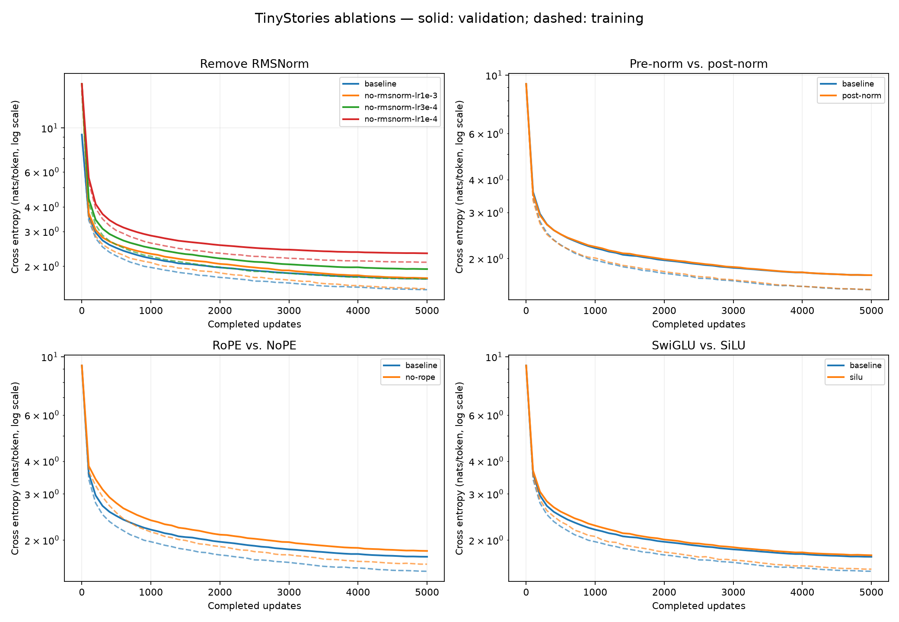
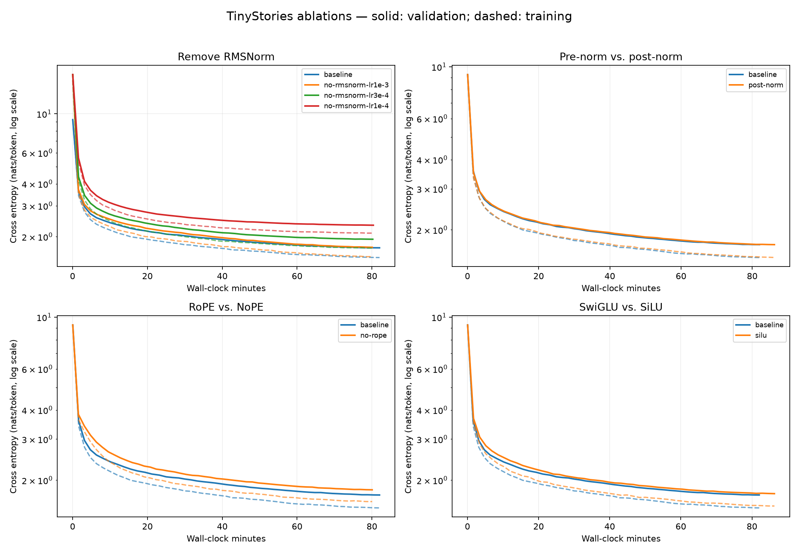

# TinyStories 消融队列结果

队列状态：`finished`。本文件在每组结束后自动更新。

正式基线验证损失 **1.7280**。下表与曲线中的训练损失来自固定 1 个训练 batch，验证损失来自固定 4 个验证 batch（正式实验为 32,768 token），不是全验证集遍历。

| 实验 | 状态 | 最后记录步数 | 训练 loss | 验证 loss | 时间/分钟 |
|---|---|---:|---:|---:|---:|
| [no-rmsnorm-lr1e-3](no-rmsnorm-lr1e-3/) | completed | 5000 | 1.5391 | 1.7400 | 80.06 |
| [post-norm](post-norm/) | completed | 5000 | 1.5221 | 1.7281 | 86.24 |
| [no-rope](no-rope/) | completed | 5000 | 1.6192 | 1.8186 | 80.07 |
| [silu](silu/) | completed | 5000 | 1.5500 | 1.7510 | 86.31 |
| [no-rmsnorm-lr3e-4](no-rmsnorm-lr3e-4/) | completed | 5000 | 1.7221 | 1.9338 | 80.23 |
| [no-rmsnorm-lr1e-4](no-rmsnorm-lr1e-4/) | completed | 5000 | 2.0951 | 2.3237 | 80.38 |

## 学习曲线

读图说明：

- **实线：验证损失（validation loss）**，反映模型在未参与参数更新的验证样本上的表现。
- **虚线：训练损失（training loss）**，反映模型对训练样本的拟合程度。这里是在固定的 1 个训练 batch 上定期评估的损失，不是每一步随机训练 batch 的即时 loss。
- **同一种颜色代表同一组实验**，该颜色的实线与虚线属于同一个模型配置；蓝色 `baseline` 是原始基线。
- 第一张图的横轴是已完成的更新步数，第二张图的横轴是墙钟时间（分钟）；纵轴均为每 token 交叉熵损失，使用对数刻度，越低越好。

比较不同消融配置时，主要比较各组的**实线**；观察同组的实线和虚线，则可以判断是否出现“训练损失继续下降、验证损失却持续上升”的过拟合迹象。两条线之间存在差距本身并不等于发生了过拟合。

未完成或失败实验只绘制已有的有限值记录，不外推后续表现。

## 本轮观察

移除 RMSNorm 的已完成候选中，最低最终验证损失来自 `no-rmsnorm-lr1e-3`：**1.7400**。这里的最好仅指本轮有限候选，不代表全局最优学习率。

- `post-norm`：最终验证损失 1.7281，相对基线变化 +0.0001（越低越好）。
- `no-rope`：最终验证损失 1.8186，相对基线变化 +0.0905（越低越好）。
- `silu`：最终验证损失 1.7510，相对基线变化 +0.0230（越低越好）。

以上是相同 token 预算、单个随机种子下的观察；改变结构后，最合适的学习率可能也改变。本轮仅对移除 RMSNorm 额外比较了较低学习率。

## 实验约定与产物

- 正式实验均从头初始化：batch=32、context=256、5,000 步，共 40.96M token；seed=42，采样顺序与固定评估样本沿用基线。
- no-rmsnorm 移除块内以及 LM head 前的全部 RMSNorm；post-norm 只改变块内归一化位置，保留输出前归一化。
- NoPE 仅去掉 Q/K 的 RoPE，保留因果掩码。SiLU 去掉第三个门控投影，d_ff 从 1344 改为 2048，近似匹配 FFN 参数量。
- 每组的 config.json、metrics.jsonl、run_info.json、checkpoint.pt 位于对应目录。失败原因保存在日志及 failure.json（非有限损失时）。
- 完整队列与代码哈希见 [manifest.json](manifest.json)，运行源码快照在 source/，各组控制台输出在同名 .log 中。
- 不覆盖原来的基线 checkpoint；本队列没有进行学习率发散边界、batch size sweep 或 OWT 实验。
