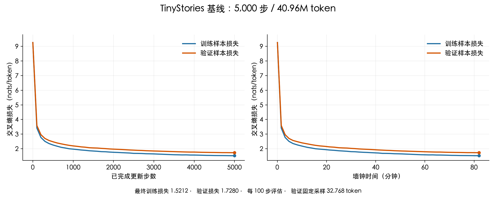

# TinyStories 训练实验记录

## 基线训练：2026-09-29

本次完成 5,000 步训练，最终训练损失 **1.5212**、验证损失 **1.7280**；验证损失的最低记录也在第 5,000 步，对应困惑度约 **5.63**。按当前验证采样口径，达到作业针对 CPU / Apple Silicon 的验证损失 ≤ 2.00 目标。

依据：[作业说明](../cs336_assignment1_basics.pdf)第 38–40 页的 `experiment_log`、TinyStories 基础配置和低资源建议。以下同时记录损失随更新步数、墙钟时间的变化。

### 配置

| 项目 | 本次设置 |
|---|---|
| 数据 | TinyStoriesV2-GPT4；自训练 10K BPE；预先编码为 `uint16` 数组 |
| 模型 | 4 层、16 个注意力头；`d_model=512`，`d_ff=1344`；RoPE θ=10000 |
| 参数量 | 22,696,448，包含 embedding 和独立 LM head |
| 训练规模 | batch size=32，context length=256，5,000 步；共 **40,960,000 token** |
| 优化器 | AdamW；β=(0.9, 0.95)，ε=1e-8，weight decay=0.1 |
| 学习率 | 前 100 步线性预热至 1e-3，之后余弦衰减；最后一次更新为 1e-4 |
| 其他 | 全局梯度裁剪阈值 1.0；随机种子 42；MPS、float32 |
| 记录与保存 | 每 100 步评估，每 1,000 步保存 checkpoint；W&B 和本地 JSONL 同步记录 |

训练时每步随机采样新 batch。曲线中的训练损失在固定的 1 个训练 batch 上计算，共 8,192 个 token；验证损失是固定的 4 个验证 batch 的平均值，共 32,768 个 token，**并非遍历完整验证集所得**。两者均为平均每 token 交叉熵（自然对数）。

### 结果与曲线



| 已完成步数 | 墙钟时间（分钟） | 训练损失 | 验证损失 |
|---:|---:|---:|---:|
| 0 | 0.04 | 9.2557 | 9.2640 |
| 100 | 1.60 | 3.4139 | 3.5859 |
| 500 | 8.28 | 2.2531 | 2.4739 |
| 1,000 | 17.29 | 1.9712 | 2.1918 |
| 2,000 | 34.88 | 1.7554 | 1.9701 |
| 3,000 | 50.63 | 1.6443 | 1.8434 |
| 4,000 | 66.29 | 1.5666 | 1.7703 |
| 5,000 | 82.03 | 1.5212 | 1.7280 |

训练与验证损失整体同步下降，前期下降较快，后期逐渐放缓，没有出现验证损失持续回升。全部 51 个记录点的损失均为有限值；本次配置收敛稳定，可以作为后续学习率、batch size 和架构消融实验的基线。

最后一个指标的墙钟时间为 **4,921.81 秒（约 82 分钟）**，计时包含训练、周期评估及此前的 checkpoint 保存，不包含数据和模型初始化、最后一次 checkpoint 保存及 W&B 收尾。第 0 到第 5,000 步之间的平均处理速度约 **8.33k token/s**，包含这段时间内的评估和保存开销。

### 运行记录与复现

- [W&B 在线实验与交互曲线](https://wandb.ai/litzgymrat-nanjing-university/cs336-assignment1/runs/ldnaejjv)：状态 `finished`。
- [实际运行配置](../data/lm_runs/tinystories-train-20260929-124145-511697/config.json)、[完整指标记录](../data/lm_runs/tinystories-train-20260929-124145-511697/metrics.jsonl)。
- [最终 checkpoint](../data/lm_runs/tinystories-train-20260929-124145-511697/checkpoint.pt)：已核对 `iteration=5000`；含模型和优化器状态。各次保存使用同一路径，当前文件是最后一次保存的结果。
- [训练入口](../train_tinystories.py)、[训练与日志实现](../cs336_basics/Training_loop/Training_loop.py)、[数据编码来源记录](../data/tokenized/20260916-user-bpe/manifest.json)。

在 `assignment1-basics` 目录运行 `uv run python -u train_tinystories.py`。本次完整配置以保存的 `config.json` 为准，后续调整脚本参数时保留这份记录作为对照。

## 此前的调试记录

| 运行 | 目的与结果 |
|---|---|
| [随机采样冒烟测试](../data/lm_runs/random-batch-smoke-20260929-120517-036265/) | 用小模型在 CPU 上执行 3 步，检查随机采样、日志和 checkpoint；不用于评价训练效果。 |
| [固定 batch 过拟合](../data/lm_runs/overfit-20260929-120517-036265/) | MPS，batch size=2、context length=64；重复训练同一 batch 40 步，训练损失从 9.2537 降至 0.000895，验证损失升至 10.3444，验证了小样本记忆能力。 |
| [中断的启动记录](../data/lm_runs/tinystories-train-20260929-123626-944382/) | 为改由用户手动启动而停止；仅保留第 0 步评估，不作为正式实验结果。 |

本次完成了基线训练记录，并达到低资源损失目标。`learning_rate` 要求的多学习率对照及至少一次发散实验仍需后续进行，不能由这一轮基线代替。

## 夜间消融队列：2026-09-29

按作业第 42–43 页的四类消融，启动以下 6 组串行实验。每组从头训练 5,000 步，使用与基线相同的 40.96M token 预算、seed=42、固定评估样本和采样顺序；基线 `1.7280` 直接复用。除下表明确列出的改动外，沿用基线配置；最低学习率统一为各组最高学习率的 1/10，预热仍为 100 步。

| 次序 | 实验 | 相对基线的改动 | 最高学习率 |
|---:|---|---|---:|
| 1 | 移除 RMSNorm | 移除块内及输出前的全部 RMSNorm | 1e-3 |
| 2 | Post-norm | 块内改为残差相加之后归一化；保留输出前 RMSNorm | 1e-3 |
| 3 | NoPE | 去掉 Q/K 的 RoPE，保留因果掩码 | 1e-3 |
| 4 | SiLU FFN | 去掉门控及第三个投影，`d_ff=2048`；参数量 22,827,520，与基线近似匹配 | 1e-3 |
| 5 | 移除 RMSNorm，较低学习率 | 同第 1 组 | 3e-4 |
| 6 | 移除 RMSNorm，更低学习率 | 同第 1 组 | 1e-4 |

其中无 RMSNorm 模型参数量为 22,691,840；Post-norm 和 NoPE 的参数量与基线相同。这里的 1e-3 是已验证的基线学习率，并非经过完整搜索的全局最优值；移除 RMSNorm 的“最好学习率”只在本轮三个候选中比较。

- [自动更新的汇总和对比曲线](../data/lm_runs/ablations-20260929-213949-817828/REPORT.md)
- [实时队列状态](../data/lm_runs/ablations-20260929-213949-817828/status.json)、[队列控制台日志](../data/lm_runs/ablations-20260929-213949-817828.log)
- [队列配置及代码哈希](../data/lm_runs/ablations-20260929-213949-817828/manifest.json)、[运行源码快照](../data/lm_runs/ablations-20260929-213949-817828/source/)
- [本次模型与训练循环的改动](../data/lm_runs/ablations-20260929-213949-817828/source_changes.patch)、[改动前的原文件](../data/lm_runs/ablations-20260929-213949-817828/source_before_changes/)
- [队列入口](../run_tinystories_ablations.py)

每组独立保存日志、配置、W&B run 链接及最终 checkpoint。出现非有限损失时，明确记录失败、结束该组并继续后续实验；不会把失败结果改写为成功。汇总文档每组结束后自动更新，并生成按更新步数和墙钟时间绘制的训练/验证曲线。队列只运行上述消融，不自动扩展到学习率发散边界、batch size sweep 或 OWT。

启动前已核对 SiLU 与 PyTorch 公式一致、NoPE 与带因果掩码的 PyTorch 注意力一致、Post-norm 调用顺序正确、无 RMSNorm 分支确实移除了全部归一化；各分支梯度均为有限值。六组均完成了 3 步 MPS 冒烟测试，checkpoint 的模型、优化器状态和步数、日志及自动绘图均检查通过；另验证了非有限损失的退出和记录路径。原有模型测试中 11 项通过，另外 2 项仍因 `tests/adapters.py` 中未接入的 `run_multihead_self_attention`、`run_silu` 抛出 `NotImplementedError`；本次没有改这两处测试接口，消融训练也不调用它们。

## 生成试用与 OWT 准备：2026-09-30

使用基线第 5,000 步 checkpoint 和与训练数据对应的 10K tokenizer，通过 [生成入口](../generate_tinystories.py) 调用已有解码函数。在 `assignment1-basics` 目录运行：

```sh
uv run --frozen python generate_tinystories.py --prompt "Once upon a time, there was a little dragon who was afraid of fire."
```

本次 temperature=0.8、top-p=0.9、seed=42，最多新增 256 token。实际新增 **89 token** 后遇到 `<|endoftext|>`，生成耗时 **6.36 秒**，不含模型与 tokenizer 加载。满足作业允许“生成至少 256 token，或遇到第一个结束标记时停止”的长度条件。[完整生成记录及 token IDs](../data/lm_runs/tinystories-train-20260929-124145-511697/generations/20260930-094343-689368.json)。以下包括输入开头：

> Once upon a time, there was a little dragon who was afraid of fire. He was very scared of the dragon, and he wanted to find out what it was.
> One day, the dragon saw a big monster in the forest. He was very scared and ran away. The dragon was very scared. He didn't know what to do.
> The dragon ran away as fast as he could and never came back. The dragon never went back to the forest again. The little dragon never went back home.
> `<|endoftext|>`

这次输出的英文句子基本通顺，但存在指代混乱、重复和情节单薄的问题。模型规模与训练预算、采样时的 temperature/top-p 都可能影响生成表现；这里只有一个配置下的一次样本，不能据此判断调节某项参数一定会改善输出。当前是英文故事续写模型，未做指令微调。

本次接入还补上了上下文窗口：模型记住 `context_len`，解码每次只送入最近 256 token，完整输出仍保留。已有 top-p 逻辑未改。另用固定输出的微型模型检查了长输入、连续生成超过窗口、窗口内容向前移动及原始 prompt 不被修改。

### OWT 可行性短测

OWT 训练/验证数据已经编码为 `uint16` NumPy 数组，分别包含 2,727,120,452 和 66,401,098 token；通过 mmap 按需读取。使用原来训练好的 32K tokenizer 所对应的数据，把模型词表改为 32K，其他结构保持不变，参数量为 **45,224,448**。

在 MPS float32、batch size=32、context length=256 下完成了 **7 步前向、反向、梯度裁剪、AdamW 更新**，随后评估了 4 个验证 batch。损失均为有限值，没有内存不足。去掉前两步，后五步平均 **1.3409 秒/步，约 6.11k token/s**；5,000 步纯训练线性估算约 **1.86 小时**，不含周期评估与 checkpoint 保存，也未反映长时间运行的温度和系统负载变化。

同步采样点中的 MPS driver 最大已分配内存约 **9.70 GB（9.04 GiB）**，包括缓存；这是若干阶段的采样值，并非严格的瞬时峰值。[短测配置、逐步时间和内存记录](../data/lm_runs/probes/owt-feasibility-20260930-094523-883086.json)。此次仅检查可运行性，没有保存短测模型或启动正式 OWT 训练。

[OWT 独立启动脚本](../train_owt.py) 沿用基线超参数、5,000 步和 40.96M token 预算，从头初始化，保存独立配置、日志、W&B 记录及 checkpoint。在 `assignment1-basics` 目录手动启动：

```sh
uv run --frozen python -u train_owt.py
```

作业第 44–45 页要求比较相同结构与训练步数下的 OWT 学习曲线和生成质量，也明确允许低资源学生继续在 TinyStories 上实验。这里把 OWT 作为下一次对照实验：短测通过只说明能运行，不能保证上述学习率在完整训练中最优或保证生成流畅。

用户随后确认沿用原配置，正式 OWT 对照训练于 2026-09-30 10:00 启动，详见 [OWT 实验记录与实时曲线](OWT_EXPERIMENTS.md)。
