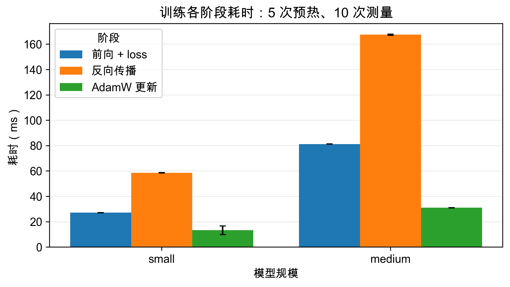
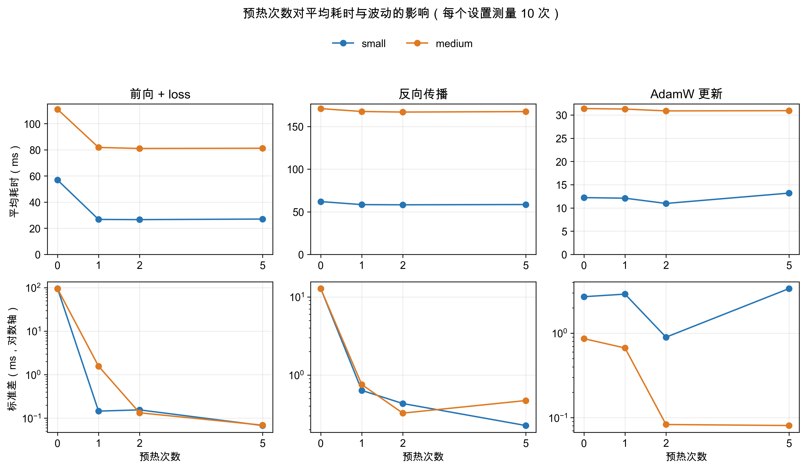

# CS336 A2 基准测量小报告

整理日期：2026-10-07。本次使用自己的 A1 Transformer 实现，在 AutoDL 单卡 RTX 4090（24 GB）上测量 small、medium 两种规模，共 14 组实验、30 条阶段或整步记录。主要观察是：一次预热后，前向与反向的均值已经接近五次预热；反向传播是三个训练阶段中耗时最多的部分。

## 实验配置与计时范围

公共配置：词表 10,000，batch size 4，序列长度 512，FP32，Pre-Norm、SwiGLU、RoPE（θ = 10,000），自写 AdamW（学习率 0.001）。模型和输入、目标均随机生成，初始化与数据生成在计时外；每组测量 10 步，基线预热 5 步，预热对照为 0、1、2、5 步。

| 规模 | d_model | d_ff | 层数 | 头数 |
| --- | --- | --- | --- | --- |
| small | 768 | 3072 | 12 | 12 |
| medium | 1024 | 4096 | 24 | 16 |

整步模式在每步计时前、后同步 CUDA；分阶段模式在各阶段边界同步。下表均为 **平均耗时 ± 样本标准差，单位 ms**，标准差来自同一次实验的 10 步，表示波动幅度，不是置信区间。前向模式保留自动求导，测量的是训练前向。

## 五次预热的基线

| 规模 | 仅模型前向 | 前向 + loss + 反向 | 完整训练一步 |
| --- | --- | --- | --- |
| small | 25.85 ± 0.06 | 86.53 ± 2.34 | 93.52 ± 0.10 |
| medium | 80.62 ± 0.23 | 247.36 ± 0.33 | 276.78 ± 0.16 |

完整训练一步包含清空梯度、前向、loss、反向及优化器更新。medium 的完整训练耗时约为 small 的 **2.96 倍**。

| 规模 | 前向 + loss | 反向传播 | AdamW 更新 |
| --- | --- | --- | --- |
| small | 27.04 ± 0.07 | 58.47 ± 0.23 | 13.20 ± 3.37 |
| medium | 81.18 ± 0.07 | 167.38 ± 0.47 | 30.93 ± 0.08 |

分阶段的前向包含交叉熵计算，清空梯度在三个阶段计时外。反向在三阶段耗时总和中的占比分别为 **59.2%、59.9%**。这些阶段由实际计时得到；额外同步改变执行组织，三阶段之和不能直接当作另一轮完整训练的耗时。

图 1：柱高为平均耗时，黑色误差条为 ±1 个样本标准差。small 的 AdamW 更新波动较大，标准差约为均值的 **25.5%**。

## 预热次数对比

此处比较的全部是 `train_stages`；每次预热执行完整训练一步。

| 规模 | 预热次数 | 前向 + loss | 反向传播 | AdamW 更新 |
| --- | --- | --- | --- | --- |
| small | 0 | 56.88 ± 95.60 | 61.93 ± 12.76 | 12.22 ± 2.70 |
| small | 1 | 26.75 ± 0.15 | 58.38 ± 0.64 | 12.10 ± 2.90 |
| small | 2 | 26.61 ± 0.16 | 58.16 ± 0.43 | 10.97 ± 0.90 |
| small | 5 | 27.04 ± 0.07 | 58.47 ± 0.23 | 13.20 ± 3.37 |
| medium | 0 | 110.93 ± 94.83 | 170.89 ± 12.72 | 31.39 ± 0.86 |
| medium | 1 | 81.78 ± 1.57 | 167.51 ± 0.76 | 31.28 ± 0.67 |
| medium | 2 | 80.99 ± 0.13 | 166.84 ± 0.33 | 30.88 ± 0.08 |
| medium | 5 | 81.18 ± 0.07 | 167.38 ± 0.47 | 30.93 ± 0.08 |

**一次预热已经带来主要改善。** 两种规模的前向与反向均值，相比五次预热的差异均小于 1.1%；零次预热时，前向标准差约 95 ms、反向约 13 ms，明显高于预热后的结果。medium 从一次增加到两次预热，部分阶段的波动仍进一步减小，因此“均值已接近”不等于“波动也完全相同”。

图 2：蓝线为 small，橙线为 medium；上排显示平均耗时，下排显示标准差。下排纵轴为对数轴，方便同时观察 0.1 ms 与近 100 ms 的波动；连线仅帮助比较离散实验点，不代表中间预热次数已经测量。

零次预热的异常符合首次执行存在额外开销的推测。[PyTorch 官方基准测试教程](https://docs.pytorch.org/tutorials/recipes/recipes/benchmark.html)也展示了首次调用加载 cuBLAS 导致明显变慢的例子；现有结果文件只保存了汇总数据，尚不能确认异常来自哪个具体初始化步骤，或集中在哪一个测量步。

**优化器受预热的影响相对较小，且结果不单调。** medium 的 AdamW 均值约 31 ms，零次与五次预热的差别约 1.5%；small 则在两次预热时测得 10.97 ± 0.90 ms，五次时为 13.20 ± 3.37 ms。因此不能由这次结果得出“预热越多，每个阶段都越快或越稳定”。

## 本次覆盖范围

结果覆盖 small、medium 的三种整步模式及训练阶段预热对照；large、xl、10B，以及整步模式的 0/1/2 次预热尚无测量记录。每个设置只有一轮 10 步测量，结果文件未记录随机种子和逐步耗时，结论限于本次配置；这些时间包含 CPU 调度与同步等待，不是纯 GPU kernel 耗时。

原始结果保留在 [outputs/benchmark](../outputs/benchmark/)，[汇总 CSV](../outputs/benchmark_summary/measurements.csv)保留原始精度及来源文件名，另有同名 LaTeX/Typst 表格与输入 CSV 的 SHA256 清单。两幅图均提供 [基线 PDF](figures/benchmark_stages.pdf) 与 [预热 PDF](figures/benchmark_warmup.pdf)。在 assignment2-systems 目录运行 `uv run python report_benchmark.py` 可重新生成报告与图表，不会启动基准测量。
