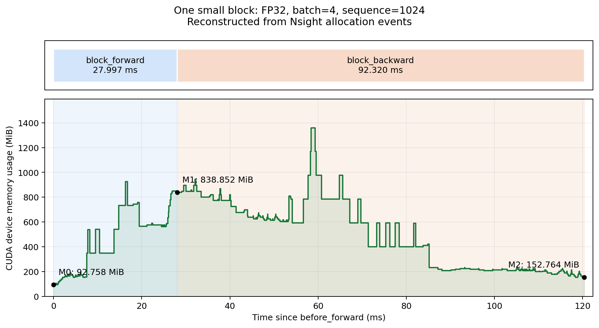
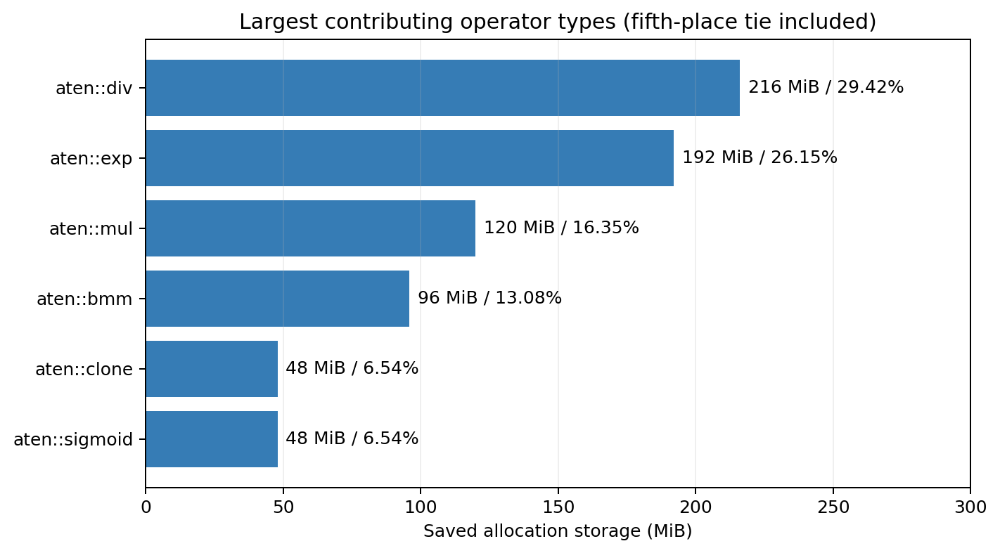

# memory_profiling (f)：单 block 显存分析

2026-10-08，RTX 4090、PyTorch 2.11.0+cu128、Nsight Systems CLI 2025.1.1。分析你已运行的正式采集，没有重新启动 GPU 实验。

使用自己的 small TransformerBlock：FP32，batch=4，序列长度 1024，d_model=768，d_ff=3072，12 头，PreNorm、SwiGLU、RoPE。预热一次后，清空参数和输入梯度，记录一次前向和一次反向。输入需要梯度，输出梯度预先创建；没有 embedding、LM head、交叉熵或优化器。这是所选 small 配置的结果，不能代替原题 xl 的测量。

## 可用于答题的解释

这个 block 在前向中新分配并保留到反向的中间存储共 **734.094 MiB**，不含已经常驻的参数、输入以及另行保留的 12 MiB 输出。最大的两个单次操作是 softmax 的 `exp` 和归一化 `div`，各保存 192 MiB，合计占 **52.31%**；SwiGLU 中五份 48 MiB 中间张量合计占 **32.69%**。因此，该实现保存的显存主要由注意力的大矩阵和 FFN 的展开表示构成，其中注意力张量形状为 `(B,H,S,S)`，随序列长度平方增长。

反向过程中，前向保存的 734.094 MiB 存储被释放，同时最终产生 **48.006 MiB** 梯度：参数梯度 **36.006 MiB**，输入梯度 **12 MiB**。这个结果与参数数量 `9,438,720 × 4` 字节及输入形状 `(4,1024,768)` 的 FP32 大小一致；反向前后显存的净下降为 **686.088 MiB**，它同时反映了旧存储释放和新梯度分配，不能直接当作释放的激活总量。

## 三个边界与反向区间

| 边界 | 报告内时间（秒） | CUDA Device Memory Usage（MiB） |
| --- | ---: | ---: |
| M0：before_forward | 4.005655372 | 92.757813 |
| M1：after_forward | 4.033670789 | 838.851563 |
| M2：after_backward | 4.126021615 | 152.763672 |

CPU 线程上的原始 `block_forward` 位于 **4.005662698–4.033659960 秒**，持续 **27.997262 ms**。原始 `block_backward` 位于 **4.033680596–4.126000827 秒**，持续 **92.320231 ms**。完整 `block_measurement` 持续 **120.376398 ms**。

你后续截图中，上方的 GPU NVTX 投影只有 `block_measurement` 和 `block_forward`，两者均为 **27.351 ms**；下方 CPU 主线程中的原始标签才包含完整 `block_backward`。这不是截图没有覆盖反向，而是两处显示的标签含义不同。对 CUDA Runtime 与 kernel 的 correlationId 核对后，正式前向的 60 个 kernel 由主线程 **21865** 提交，第一至最后一个 kernel 的跨度为 **27.351333 ms**，正好对应上方的投影。反向的 109 个 kernel 全部由另一个线程 **21921** 提交；主线程上的 `block_backward` 包含调用与等待，但没有在自身线程里提交这些 kernel，因此没有对应的 GPU 投影。工作线程自己的 `autograd::engine`、`DivBackward` 等标签仍可投影到上面。之前将这一现象归因于截图范围的解释不准确，在此更正。

GPU 投影根据 NVTX 区间内关联的 GPU 操作生成范围，起止位置是第一项操作开始至最后一项操作结束，跨度包含其中的间隙，不等于所有 kernel 时长之和。读本题时，用下方 CPU 原始标签划定完整前向/反向，再沿同一时间轴读取 CUDA Memory Usage 和 GPU kernel；不要把上方 27.351 ms 当成整步时长。[Nsight GPU 投影说明](https://docs.nvidia.com/nsight-systems/AnalysisGuide/index.html#nvtx-gpu-proj-sum-nvtx-gpu-projection-summary)

这里读的是变化的 **Memory Usage** 行，统计运行时 Device 分配，包括参数等长时间保留的张量。另一行 **Static Memory Usage** 为 481.766 KiB；它表示 CUDA 静态内存，不能把它解释成模型参数大小。初始化得到的参数也属于运行时分配。[Nsight 显存追踪说明](https://docs.nvidia.com/nsight-systems/UserGuide/index.html#cuda-gpu-memory-allocation-graph)

M0 包含已经创建的参数、输入、上游梯度、RoPE buffer 和库分配等。这个入口在两个阶段结束时都保留输出，因此本次经分配记录核对成立的关系是：

```text
新增保存存储 = M1 - M0 - 输出
             = 838.8515625 - 92.7578125 - 12
             = 734.09375 MiB

最终梯度     = M2 - M0 - 输出
             = 152.763671875 - 92.7578125 - 12
             = 48.005859375 MiB
```



上图从 Nsight 原始 malloc/free 事件重绘，横轴相对 `before_forward`；它不是 Nsight 界面截图。蓝色为前向，浅橙色为反向。前向末尾的 M1 包含保留存储；阶段内部的尖峰还包含临时存储，尤其反向中的短暂峰值不能用来代替保存量。

## 贡献最大的操作类型

按产生存储的操作类型汇总，同一块存储只计一次；所有百分比的分母均为 **734.09375 MiB**。

| 排名 | 操作类型 | 保存存储（MiB） | 占比 | 对应计算 |
| ---: | --- | ---: | ---: | --- |
| 1 | `aten::div` | 216 | 29.42% | softmax 归一化 192，加两个 RMSNorm 除法各 12 |
| 2 | `aten::exp` | 192 | 26.15% | softmax 指数结果 |
| 3 | `aten::mul` | 120 | 16.35% | 两个 RMSNorm 乘法各 12，加 SiLU 与门控乘法各 48 |
| 4 | `aten::bmm` | 96 | 13.08% | SwiGLU 的两次展开投影，各 48 |
| 5（并列） | `aten::clone` | 48 | 6.54% | 注意力/RoPE 重排中的四次实际拷贝，各 12 |
| 5（并列） | `aten::sigmoid` | 48 | 6.54% | SwiGLU 的 sigmoid 结果 |

第五名并列，因此保留两项，而不是任意删掉一项。完整 12 种类型见 [CSV](../outputs/block_memory/analysis/saved_by_operator.csv)。`clone` 的申请子调用是 `empty`，表中归属到最近的实际计算算子；原始标签仍保存在明细中。这里的 `bmm` 是当前 einsum 实现展开投影时调用的底层操作，并非注意力的两个矩阵乘法保存量。



若题目的“操作”按**一次具体调用**理解，则前两名各为 192 MiB，其后五次调用均为 48 MiB，并列第三；列出所有并列项如下，避免把多个调用汇总后的 216 MiB 当成单次除法大小。

| 单次操作 | 前向 seq | 保存存储（MiB） | 占比 |
| --- | ---: | ---: | ---: |
| softmax 指数 `exp` | 267 | 192 | 26.15% |
| softmax 归一化 `div` | 269 | 192 | 26.15% |
| SwiGLU 的 W1 展开投影 `bmm` | 316 | 48 | 6.54% |
| SwiGLU 的 `sigmoid` | 320 | 48 | 6.54% |
| SiLU 的逐元素乘法 `mul` | 321 | 48 | 6.54% |
| SwiGLU 的 W3 展开投影 `bmm` | 331 | 48 | 6.54% |
| SwiGLU 的门控乘法 `mul` | 335 | 48 | 6.54% |

softmax 的两份张量大小都是 `4 × 12 × 1024² × 4 / 1024² = 192 MiB`；FFN 每份展开表示为 `4 × 1024 × 3072 × 4 / 1024² = 48 MiB`。这也解释了为什么逐元素操作虽然 FLOPs 少，却可能保存很大的张量：它操作的是注意力分数矩阵。今后学习 FlashAttention 时，可以把“避免在显存中保留完整的 S×S 中间矩阵”与本次结果对应起来。

## 核对与复现

分析按 CUDA malloc 的 correlationId、CPU 线程和其所在的 NVTX 区间定位申请操作，并追踪地址的每次申请/释放，处理地址复用。只计前向申请、前向末尾仍然保留、反向期间释放的 25 块存储；另外一块 12 MiB 输出保留到反向后。最终 10 块梯度存储的总量与实际 `.grad` 字节数完全一致。view 共享的存储不重复计数，临时张量不计入保存量。

正式记录中 175 个反向序号与 175 个前向序号匹配。当前 PyTorch 标签两边写作 `seq = N`，反向另含 `Backward`；使用阶段和序号进行对应。[PyTorch NVTX 标签说明](https://docs.pytorch.org/docs/2.11/autograd.html#torch.autograd.profiler.emit_nvtx)

采集子进程关闭了 CUDA memory caching，使释放的存储能在 Nsight malloc/free 中体现。这个设置与 profiler 都会改变执行开销，因此上述时长只用于定位阶段，不和普通 benchmark 比速度。本次统计的是新申请的存储；已在 M0 中存在、反向也需要读取的参数和输入没有再次计入。[PyTorch 显存管理](https://docs.pytorch.org/docs/2.11/notes/cuda.html#memory-management)

- [原始 Nsight 报告](../outputs/block_memory/small_b4_s1024_fp32.nsys-rep) 与 [SQLite 事件](../outputs/block_memory/small_b4_s1024_fp32.sqlite)
- [配置与实际梯度大小](../outputs/block_memory/small_b4_s1024_fp32.json)、[采集命令和返回码](../outputs/block_memory/small_b4_s1024_fp32.command.json)
- [保存存储的逐块明细](../outputs/block_memory/analysis/saved_allocations.csv)、[单次操作表](../outputs/block_memory/analysis/saved_by_operator_instance.csv)
- [分析与校验 JSON](../outputs/block_memory/analysis/block_memory_analysis.json)、[边界读数表](../outputs/block_memory/analysis/memory_boundaries.csv)

五项核对均通过：实际源码哈希、申请/释放大小、保存存储与边界差值、梯度存储与实际张量大小、前向/反向序号。项目目录里的下载文件与服务器原始文件一致。Downloads 中你打开的文件和服务器文件字节不同，但两份 SQLite 的全部 NVTX 标签/区间、CUDA Runtime 关联映射、显存分配/释放事件均逐项一致，分析对应同一份采集。上述图和表已保存；你在对话中提供的 Nsight 原生截图没有被另存为本地文件，若提交要求附件截图，需要保存界面截图。

仅重新分析已有文件，在 assignment2-systems 中运行：

```bash
.venv/bin/python analyze_block_memory.py
```

该命令不启动 GPU。分析脚本生成 CSV、LaTeX、Typst 表格和 PNG/PDF 图表，便于后续报告复用。
