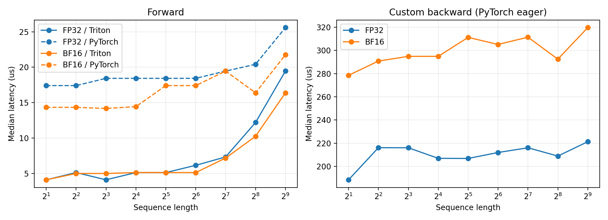

# FlashAttention 前向与未编译反向测量

运行设备：NVIDIA GeForce RTX 4090；PyTorch 2.11.0+cu128，Triton 3.6.0。

按本次选定方案，共 54 组：三项测量 × FP32/BF16 两种输入类型 × 九档序列长度。
batch=1，单头维度=64（沿用 medium 的 d_model=1024、16 heads），因果掩码开启。
这里没有创建完整的 medium Transformer，也没有投影层、loss 或优化器。

## 计时边界

1. Triton 前向：自定义 autograd.Function 的调用，包括输出/L 分配与 kernel 启动。
2. 普通 PyTorch 前向：显式 QKᵀ、缩放、掩码、softmax、PV；不调用 SDPA/FlashAttention。
3. 当前实现反向：调用 backward，重算分数/概率并生成 Q、K、V 梯度；关闭 torch.compile。反向仍由 PyTorch 执行，不是 Triton 反向 kernel。

随机输入、上游梯度和普通 PyTorch 使用的掩码均在计时前生成。前向开启 autograd。
反向计时前已完成前向，重复测量使用 retain_graph=True；不包含前向，也不包含 loss。
do_bench 在每次正式反向计时前清空输入梯度，防止测成梯度累加。

使用 [triton.testing.do_bench](https://triton-lang.org/main/python-api/generated/triton.testing.do_bench.html)，
warmup=25 ms、rep=100 ms，保存全部 CUDA event 样本。下表采用中位数，单位 µs；均值和标准差见原始 CSV。
do_bench 会清理 L2 cache；非常短的运算仍受启动、CPU 提交间隙和 event 分辨率影响，不是纯数学运算的理论时间。

## 结果

加速比 = 普通 PyTorch 前向耗时 / Triton 前向耗时，只比较相同输入精度的前向。

### FP32

| 序列长度 | Triton 前向 µs | PyTorch 前向 µs | 未编译反向 µs | 前向加速比 |
| ---: | ---: | ---: | ---: | ---: |
| 2 | 4.096 | 17.408 | 188.416 | 4.25× |
| 4 | 5.120 | 17.408 | 216.128 | 3.40× |
| 8 | 4.096 | 18.432 | 216.064 | 4.50× |
| 16 | 5.120 | 18.432 | 206.944 | 3.60× |
| 32 | 5.120 | 18.432 | 206.848 | 3.60× |
| 64 | 6.144 | 18.432 | 211.968 | 3.00× |
| 128 | 7.328 | 19.456 | 216.064 | 2.66× |
| 256 | 12.192 | 20.416 | 208.896 | 1.67× |
| 512 | 19.456 | 25.600 | 221.280 | 1.32× |

### BF16

| 序列长度 | Triton 前向 µs | PyTorch 前向 µs | 未编译反向 µs | 前向加速比 |
| ---: | ---: | ---: | ---: | ---: |
| 2 | 4.096 | 14.336 | 278.528 | 3.50× |
| 4 | 4.992 | 14.336 | 290.848 | 2.87× |
| 8 | 4.992 | 14.176 | 294.912 | 2.84× |
| 16 | 5.120 | 14.432 | 294.912 | 2.82× |
| 32 | 5.120 | 17.408 | 311.296 | 3.40× |
| 64 | 5.120 | 17.408 | 305.152 | 3.40× |
| 128 | 7.168 | 19.456 | 311.456 | 2.71× |
| 256 | 10.240 | 16.384 | 292.480 | 1.60× |
| 512 | 16.384 | 21.760 | 319.712 | 1.33× |



左图实线表示 Triton 前向，虚线表示普通 PyTorch 前向；蓝色为 FP32，橙色为 BF16。右图两条线都是未编译的自定义反向。
曲线连接不同配置的中位数，没有绘制置信区间。

## 怎样理解结果

- FP32：长度 512 时，前向 19.456 µs 对 25.600 µs，加速 1.32×；未编译反向从长度 2 的 188.416 µs 变为长度 512 的 221.280 µs。
- BF16：长度 512 时，前向 16.384 µs 对 21.760 µs，加速 1.33×；未编译反向从长度 2 的 278.528 µs 变为长度 512 的 319.712 µs。
- 这批输入很小：短序列的算术工作增加，未必能明显改变耗时。融合前向减少算子启动和中间矩阵读写，因此即使小输入也能获益。
- 未编译反向包含多次 PyTorch 调用、掩码构造、矩阵乘法和类型转换。短序列区间中，提交和启动开销可能比算术增长更显著；本轮没有采集 Nsight，不能把每一项耗时直接分摊。
- BF16 的计算量不变；低精度乘法的吞吐量收益需要足够大的工作量。当前长度 2–512 的结果不能代表长序列或 GPU 满负载时的收益。

## 类型修正与数值检查

修正前的 BF16 前向编译失败：kernel 写入的 logsumexp 是 FP32，外部 L 却按输入分配成 BF16。
L 现为 FP32；反向重算 S、dP 和 D 使用 FP32，参与梯度矩阵乘法时再与 Q/K/V 的 BF16 类型对齐。
只使用 BF16 张量输入，没有开启 autocast；内部保留 FP32 统计量和累计精度，是显式的精度安排。

当前 FP32 的 tl.dot 使用默认 TF32；普通 PyTorch 也允许 TF32。FP32 指张量类型，不代表矩阵乘法采用严格 IEEE FP32。
相关规则见 [Triton tl.dot](https://triton-lang.org/main/python-api/generated/triton.language.dot.html)。

每组配置在计时前，与已量化输入转回 FP32、关闭 TF32 的独立参考比较输出及三个输入梯度。
54 条测量记录中，54 条满足 rtol=atol=0.01；全部输出和梯度均为有限值。
前向最大相对 L2 误差为 0.003607；反向三种梯度的最大相对 L2 误差为 0.006416。
完整误差和实际 dtype 在 benchmark.json/checks 中，逐元素最大误差也保存在 CSV。官方四个 Triton 测试结果在 pytest.log 中。

现有 kernel 的 Q 读取没有边界检查。为按计划安全测量长度 2/4/8，输入底层存储至少分配 16 行，逻辑张量仍只暴露实际序列长度。
两种实现使用相同输入，额外存储的分配不计时。这种输入安排不意味着原 kernel 已支持任意短张量的存储布局。

## batch 为什么固定为 1

输入形状是 (B, S, d)，分数矩阵是 (B, S, S)，每个样本独立计算，不跨样本关注。
主要矩阵乘法前向计算量约 4BS²d，因此 batch 从 1 到 4，计算量和主要张量内存都增为四倍；耗时不保证是四倍。
例如 S=128、Q tile=16 时，batch=1 启动 8 个 program，batch=4 启动 32 个。更多独立 program 可以并行，可能提高小配置的 GPU 利用率。
比较不同 batch 时，单次调用延迟处理的是整个 batch；每样本延迟可用 t/B、吞吐量可用 BS/t 表达。这里没有实测 batch=4，不把可能的利用率改善当作已验证结论。

从实验设计上，固定 batch=1 排除了 batch 变化的影响，便于观察 S 和 d，也降低长序列的显存压力。
S=65536 时，一张 FP32 分数矩阵在 batch=1 就有 16 GiB，batch=4 则是 64 GiB，还没包括概率、梯度或其他中间值。

## 本轮范围与复现

本轮按选定范围测 RTX 4090、单头维度 64、长度 2–512 的三项耗时。没有测普通 PyTorch 反向或端到端前向+反向。
题目原文的完整表还要求 B200、长度 128–65536、维度 16–128 的笛卡尔积以及两种实现的三种阶段；本轮是开发对照实验，不是完整提交矩阵。

服务器项目目录下重测：

```bash
.venv/bin/python -m cs336_systems.benchmark_flash_attention --batch_size 1 --head_dim 64 --precisions fp32 bf16 --output_prefix outputs/flash_attention/final/benchmark
```

本地只重新整理结果：

```bash
uv run --no-sync python report_flash_attention.py
```

完整记录：outputs/flash_attention/final/benchmark.csv、benchmark.json（含原始时间样本）、summary.csv、run.log、pytest.log。
source_snapshot 保存实际测量代码，artifact_manifest.json 用于核对远端下载文件；source_sha256 记录源文件版本。
