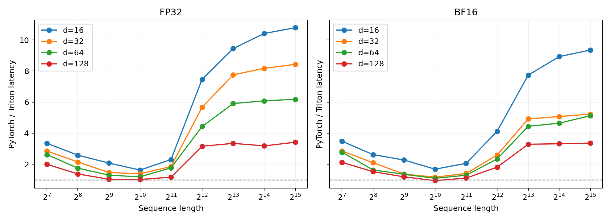

# FlashAttention 前向：完整尺寸扫描

设备：NVIDIA GeForce RTX 4090, 24564 MiB；PyTorch 2.11.0+cu128；Triton 3.6.0；CUDA 12.8。

按本次要求仅比较前向：序列长度 128、256、512、1024、2048、4096、8192、16384、32768、65536；
单头维度 16、32、64、128；FP32/BF16 张量输入；batch=1；因果掩码开启。
这是 80 套输入 × 两种实现 = 160 条测量，未测反向或完整 Transformer。没有使用 autocast。
实际成功 152 条，OOM 8 条；失败项保留，不赋予耗时或加速比。

- 长度 65536：当前 Triton 在四种 d、两种精度下都成功；当前普通 PyTorch 在这八套输入中均 OOM。
- 长度 32768：FP32 前向加速 3.42～10.79 倍；BF16 为 3.36～9.35 倍，差异主要随 d 改变。
- 短、中等序列的部分配置耗时接近，BF16 的一个配置中 Triton 略慢。省显存与加速比是两项独立结果。

## 怎样读图

每张八格图的上排是 FP32，下排是 BF16；每列对应一种 d。蓝色实线表示 Triton，橙色虚线表示普通 PyTorch。
横纵坐标均为对数刻度；点表示当前配置的中位数，连线只连接实测成功的配置。OOM 在对应格中标注。




加速比 = 同一 S、d、dtype 下的普通 PyTorch 前向耗时 / Triton 前向耗时；1× 表示耗时相同。


## 计时和显存的边界

Triton 直接调用当前 FlashAttention2_with_triton.apply，沿用原 kernel 和 16×16 tile，核心文件没有修改。
普通 PyTorch 显式计算 QKᵀ、缩放、因果掩码、softmax 和 PV；不调用 SDPA，不使用 torch.compile。
两者都开启 autograd，仅执行前向。每次调用的输出和计算图在下一次调用前释放，不累积多份计算图。
随机输入以及 PyTorch 的完整因果掩码在计时前生成，两种实现使用相同 seed 和实际输入值。

采用 [triton.testing.do_bench](https://triton-lang.org/main/python-api/generated/triton.testing.do_bench.html) 的 CUDA events；
warmup=25 ms，rep 至少 100 ms。长序列按一次预热后调用耗时的 20 倍增加测量预算，实际样本数和全部原始时间均保存。
首次 JIT、输入/掩码生成、正确性校验、CSV 写入不计时；do_bench 会在正式样本前清理 L2。

显存另测一次预热后的前向，使用 max_memory_allocated，不包含校验或 do_bench 的缓存清理缓冲。
总峰值包含 Q/K/V、输出、前向保存项以及当时活跃的临时张量；PyTorch 还包含提前构造的因果掩码。
input_allocated_mib 和 forward_extra_mib 同时记录，可区分调用前已有张量与前向新增峰值。
短序列的 PyTorch 预热后已有约 8 MiB 固定分配，基线显存还包括这部分；小配置的总峰值差不能全归因于注意力激活。
这是 PyTorch 追踪的张量分配量，不是 allocator reserved、整个进程显存，也不包括片上寄存器/共享内存。

## 结果与解释

### FP32

| d | 最长可对照 S | Triton ms | PyTorch ms | 加速比 | Triton 峰值 MiB | PyTorch 峰值 MiB |
| ---: | ---: | ---: | ---: | ---: | ---: | ---: |
| 16 | 32768 | 4.6607 | 50.2881 | 10.79× | 8.12 | 10256.38 |
| 32 | 32768 | 5.9649 | 50.2907 | 8.43× | 16.12 | 10264.38 |
| 64 | 32768 | 8.3702 | 51.7370 | 6.18× | 32.12 | 10280.38 |
| 128 | 32768 | 15.1082 | 51.6116 | 3.42× | 64.12 | 10312.38 |

- S=65536、d=16：Triton 19.0111 ms、峰值 16.25 MiB；PyTorch OOM。
- S=65536、d=32：Triton 22.0978 ms、峰值 32.25 MiB；PyTorch OOM。
- S=65536、d=64：Triton 32.4905 ms、峰值 64.25 MiB；PyTorch OOM。
- S=65536、d=128：Triton 61.2060 ms、峰值 128.25 MiB；PyTorch OOM。

### BF16

| d | 最长可对照 S | Triton ms | PyTorch ms | 加速比 | Triton 峰值 MiB | PyTorch 峰值 MiB |
| ---: | ---: | ---: | ---: | ---: | ---: | ---: |
| 16 | 32768 | 2.8739 | 26.8810 | 9.35× | 4.12 | 6156.38 |
| 32 | 32768 | 5.1415 | 26.8998 | 5.23× | 8.12 | 6160.38 |
| 64 | 32768 | 5.2703 | 27.0218 | 5.13× | 16.12 | 6168.38 |
| 128 | 32768 | 8.1295 | 27.3177 | 3.36× | 32.12 | 6184.38 |

- S=65536、d=16：Triton 11.8528 ms、峰值 8.25 MiB；PyTorch OOM。
- S=65536、d=32：Triton 18.4279 ms、峰值 16.25 MiB；PyTorch OOM。
- S=65536、d=64：Triton 20.9296 ms、峰值 32.25 MiB；PyTorch OOM。
- S=65536、d=128：Triton 32.3727 ms、峰值 64.25 MiB；PyTorch OOM。

### 显存为何差这么多

普通注意力需要形状 (1,S,S) 的分数/概率及相关临时张量。一张矩阵的大小为 S²×每元素字节数。
S=65536 时，一张 FP32 矩阵就是 16 GiB，BF16 是 8 GiB；完整前向的峰值还包含掩码、另一张矩阵和算子临时输出。
BF16 输入减少单个矩阵的空间，但不能保证多个矩阵同时出现时适配 24 GiB 显卡。

当前 Triton kernel 将分数和概率限制在 16×16 tile 内，在全局显存只保存 Q/K/V、O 和每行一个 FP32 的 L。
这部分约为 4Sd×输入字节数 + 4S 字节；S=65536、d=128 时，FP32 为 128.25 MiB，BF16 为 64.25 MiB。
S 翻倍时这部分约翻倍；普通注意力的大矩阵约变为四倍。显存曲线直接检验这个区别。
这种注意力测量没有 embedding、FFN、模型参数或优化器状态，因此不能用其显存推断完整模型可训练的长度。

### 耗时如何解释

- FP32、d=16：Triton 长度 32768→65536，延迟变为 4.08 倍。
- FP32、d=128：Triton 长度 32768→65536，延迟变为 4.05 倍。
- BF16、d=16：Triton 长度 32768→65536，延迟变为 4.12 倍。
- BF16、d=128：Triton 长度 32768→65536，延迟变为 3.98 倍。
- BF16、S=1024、d=128：Triton 37.89 µs，PyTorch 35.84 µs（0.95×）。这是接近持平、Triton 略慢的配置；小差值不宜解读成稳定的大幅劣势。

FlashAttention 改变读写和中间量的保存方式，主要 QKᵀ/PV 算术量仍约为 4S²d。本 kernel 对因果掩码上方的 tile 也做点积再掩盖。
因此省显存并不等于计算量变为线性；长序列仍可能表现出接近二次的耗时增长。
分块、融合和避免把注意力矩阵写回全局显存，是 [FlashAttention 原论文](https://arxiv.org/abs/2205.14135) 的主要方法。
短序列只有少量 program，例如 S=128、Q tile=16 时只有 8 个；提交/启动开销与不足的并行度都可能限制收益。
本轮没有采集 Nsight 或做 tile 调优，不能把这些可能原因当成已证实的瓶颈。测到 Triton 较慢时也保留结果。

BF16 张量类型不意味着所有内部统计都是 BF16：当前 kernel 的分数、m、l 和 O 累计为 FP32，P 在与 V 做点积前转为 V 的类型；L 仍为 FP32。
FP32 的 tl.dot 沿用默认 TF32，普通 PyTorch 同样允许 TF32；这组是 FP32 张量输入，不是严格 IEEE FP32 矩阵乘法对照。
相关输入精度规则见 [tl.dot 文档](https://triton-lang.org/main/python-api/generated/triton.language.dot.html)。

### 分别改变维度和精度

- 固定 S=32768、FP32，d 从 16 增到 128（8 倍）：Triton 4.6607→15.1082 ms（3.24 倍）；PyTorch 50.2881→51.6116 ms（1.03 倍）。
- 固定 S=32768、BF16，d 从 16 增到 128（8 倍）：Triton 2.8739→8.1295 ms（2.83 倍）；PyTorch 26.8810→27.3177 ms（1.02 倍）。
- 固定 S=32768、d=16，FP32→BF16：Triton 延迟比为 1.62，PyTorch 为 1.87；峰值显存分别从 8.12→4.12 MiB、10256.38→6156.38 MiB。
- 固定 S=32768、d=128，FP32→BF16：Triton 延迟比为 1.86，PyTorch 为 1.89；峰值显存分别从 64.12→32.12 MiB、10312.38→6184.38 MiB。

d 增大使主要点积算术量成比例增大，但普通注意力的 S×S 分数/概率尺寸不随 d 改变。
因此耗时不一定随 d 成比例变化：固定启动、内存读写以及乘法的实际吞吐也参与决定结果。
低精度也不保证每个尺寸都按固定倍数加速；PyTorch 的布尔因果掩码不随 FP32→BF16 减半，其总峰值显存不会严格减半。

## 数值检查和失败记录

成功配置的全部输出检查 NaN/Inf；S≤512 检查所有 query 行，更长输入抽查均匀分布的行和 tile 边界附近的行。
独立参考使用当前输入值转换为 FP32，并关闭 TF32；参考只生成所选 query 行的分数，避免校验先因完整 S×S 矩阵 OOM。
比较输出，Triton 还比较这些行的 logsumexp；rtol=atol=0.01。长序列的误差统计来自抽查行，不宣称逐元素完整参考验证。
本轮成功项全部满足容差；抽查/全行比较的最大相对 L2 误差为 0.004391。

每项启动独立进程；OOM 保存实际阶段和异常，不跳过尺寸、不自动降精度或修改 batch。

| 实现 | 精度 | 序列长度 | 维度 | OOM 阶段 |
| --- | --- | ---: | ---: | --- |
| pytorch_forward | fp32 | 65536 | 16 | first_forward |
| pytorch_forward | bf16 | 65536 | 16 | first_forward |
| pytorch_forward | fp32 | 65536 | 32 | first_forward |
| pytorch_forward | bf16 | 65536 | 32 | first_forward |
| pytorch_forward | fp32 | 65536 | 64 | first_forward |
| pytorch_forward | bf16 | 65536 | 64 | first_forward |
| pytorch_forward | fp32 | 65536 | 128 | first_forward |
| pytorch_forward | bf16 | 65536 | 128 | first_forward |

## 完整数据与复现

80 行对照表在 outputs/flash_attention/forward_sweep/summary.csv；160 条原始结果在 benchmark.csv/json。
CSV 保存均值、中位数、标准差、样本数、显存和检查范围；JSON 保存所有时间样本，cases/ 保留每次运行的结果和 OOM 错误。

服务器项目目录：

```bash
.venv/bin/python -m cs336_systems.benchmark_flash_forward
```

本地只重建报告：

```bash
uv run --no-sync python report_flash_forward.py
```

本轮覆盖题目要求的 S×d×dtype 尺寸范围，但按当前讨论只测前向，硬件是 RTX 4090。题目完整提交仍要求 B200 以及反向/端到端表。
