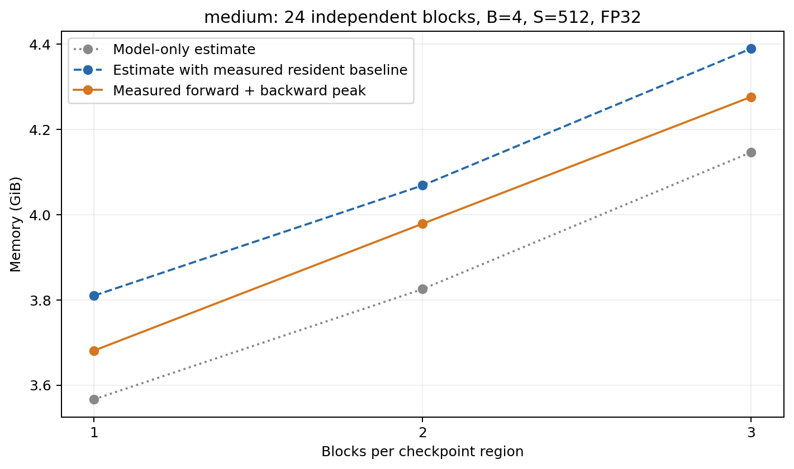

# gradient_checkpointing (b)：分组与显存峰值

2026-10-08，RTX 4090，PyTorch 2.11.0+cu128，CUDA 12.8。

## 可用于答题的解释

按本次选定的 medium 配置，单个检查点入口为 **8.000 MiB**，单 block 新增并保存的中间存储为 **360.891 MiB**。
在不嵌套、以完整 block 为单位分组的限制下，用 `K×M(C)+(24/K)×M(B)` 估计激活峰值，连续最优 K≈32.904 超过 24 层，因此预测每段 1 个 block 最省显存。
该点已经是最小合法分组，没有每段 0 个 block 的左邻，故比较每段 1、2、3 个 block；完整前向、重算和反向的实测峰值分别为 **3.681、3.979、4.277 GiB**。
每段 1 个 block 在这三组中最低，与理论预测一致；分组变大节省的入口存储不足以抵消段内重算时更多中间值同时存在的开销。

## 配置与测量边界

使用你自己的 TransformerBlock：d_model=1024、d_ff=4096、24 层、16 头、batch=4、context=512、FP32、PreNorm、SwiGLU、RoPE；24 层的权重相互独立。
每组一个独立 GPU 进程，固定种子 0，预热一次，然后清空参数和输入梯度、同步 GPU、清除预热历史并重置峰值，正式运行一次完整前向与反向。
输入需要梯度，输出梯度提前创建；采集包含反向中的重算，保留输出到反向结束，没有 embedding、LM head、交叉熵或优化器。
这三组验证的是用户指定的 medium/512 配置，原题的 xl/batch=4/context=2048 没有运行；也没有穷举所有分组的 GPU 测量。

峰值使用 `torch.cuda.max_memory_allocated()`，单位 GiB=1024³ 字节。它记录 PyTorch 管理的分配峰值，包括参数、梯度、激活和临时分配；不是 allocator 保留显存，也不是 `nvidia-smi` 的整进程占用。[PyTorch 峰值统计说明](https://docs.pytorch.org/docs/2.11/generated/torch.cuda.memory.max_memory_allocated.html)

## 理论演算：用均值不等式选择 K

目标是在不嵌套、均匀分组的近似模型里，选择段数 K，使激活峰值最小。设 N 为总 block 数，M(C) 为一份入口检查点大小，M(B) 为一个 block 内部的保存存储大小。
K 段的入口要保存 K×M(C)；反向处理一段时，最多重建 N/K 个 block 的中间值，所以使用你提出的估计：

\[
M_{\mathrm{act}}(K)\approx K M(C)+\frac{N}{K}M(B).
\]

两项均为正，且乘积与 K 无关：

\[
\left[K M(C)\right]\left[\frac{N}{K}M(B)\right]=N M(C)M(B).
\]

由均值不等式，有

\[
K M(C)+\frac{N}{K}M(B)\ge 2\sqrt{N M(C)M(B)}.
\]

等号当且仅当两项相等：

\[
K M(C)=\frac{N}{K}M(B)
\quad\Longrightarrow\quad
K^2=\frac{N M(B)}{M(C)}
\quad\Longrightarrow\quad
K^*=\sqrt{\frac{N M(B)}{M(C)}}.
\]

本次入口是形状 (4,512,1024) 的 FP32 张量，因此

\[
M(C)=\frac{4\times512\times1024\times4}{1024^2}=8.000\ \mathrm{MiB}.
\]

M(B) 使用当前实现的保存存储校准值 **360.890625 MiB**，不是从参数数量推出来的，也不是一个 block 的完整显存峰值。代入 N=24：

\[
M_{\mathrm{act}}(K)\approx 8K+\frac{24\times360.890625}{K}
=8K+\frac{8661.375}{K}\quad(\mathrm{MiB}),
\]

\[
K^*=\sqrt{\frac{24\times360.890625}{8}}
\approx 32.904.
\]

均值不等式给出的连续下界是 526.464 MiB，但合法范围是 1≤K≤24；每段至少包含一个完整 block，所以本次无法取到 K≈32.904。
需要再检查受约束的最优点，不能直接把无法达到的等号条件当作答案。对上述近似表达式求导，在合法范围内：

\[
M'_{\mathrm{act}}(K)=8-\frac{8661.375}{K^2}
\le 8-\frac{8661.375}{24^2}
=-7.037109<0.
\]

因此它在合法范围内随 K 增大而减小，选 K=24，也就是每段 1 个 block。
这说明“两项相等”是能够达到时的内点最优条件；受边界约束时，最优点可以不相等。本次最优点的两项分别为 192.000 和 360.890625 MiB。

三种实测分组对应的激活估计为：

- 每段 1 个 block，K=24：24×8+1×360.890625=552.890625 MiB。
- 每段 2 个 block，K=12：12×8+2×360.890625=817.781250 MiB。
- 每段 3 个 block，K=8：8×8+3×360.890625=1146.671875 MiB。

这三种分组都能整除 24 层。加入本近似模型中的固定内存项不改变最优分组；完整峰值的估计与实测差异在下表中另外说明。


## 理论与实测

参数为 402,702,336 个 FP32 元素，共 1.500183 GiB；最终参数梯度字节数相同。表中的激活估计沿用你的两项公式：检查点入口存储加上一个分组的段内保存存储。
“模型估计”再加参数、全部参数梯度、buffer，以及输出、上游梯度和输入梯度；入口 x 已算在检查点项中，不重复加。

| 每段 block 数 | K：段数 | 检查点（MiB） | 段内中间存储估计（MiB） | 模型估计（GiB） | 常驻基线校正后估计（GiB） | 实测完整峰值（GiB） |
| ---: | ---: | ---: | ---: | ---: | ---: | ---: |
| 1 | 24 | 192.000 | 360.891 | 3.567 | 3.810 | **3.681** |
| 2 | 12 | 96.000 | 721.781 | 3.825 | 4.069 | **3.979** |
| 3 | 8 | 64.000 | 1082.672 | 4.147 | 4.390 | **4.277** |

正式测量起点没有参数梯度，但实际分配比“参数+buffer+输入+上游梯度”多 **249.141 MiB**，三组一致。
这部分是预热后仍常驻、未被模型元素计数覆盖的分配；本次没有按调用栈进一步归属，不能直接指定它来自哪个库。
“常驻基线校正后估计”将这部分加回原模型估计，让实际存在的共同基线进入对比。
两种估计都不是精确峰值公式：它们假定全部梯度、全部入口检查点和一整段保存存储同时存在，却没有逐时刻描述它们的释放，也没有完整计入反向临时张量。
因此理论主要用于预测最优分组和变化方向，实际峰值仍以采集为准；不能拿总峰值减去全部梯度大小，直接宣称剩余值就是激活峰值。



图中灰色点线是模型估计，蓝色虚线是在模型估计上加入实测额外常驻基线，橙色实线是完整前向/反向的实测峰值。

| 每段 block 数 | 前向结束分配（GiB） | 完整过程峰值（GiB） |
| ---: | ---: | ---: |
| 1 | 1.950 | 3.681 |
| 2 | 1.856 | 3.979 |
| 3 | 1.825 | 4.277 |

这里最容易混淆的地方是：**前向结束的保存量随分组变大而下降，完整峰值却上升**。
更多 block 放在同一段时入口检查点减少，但反向处理该段前要重建更多中间值，所以优化对象应是整个过程的最大值。

## 重算量与耗时

在每段完整重算一次的理想模型里，每个 block 都额外前向一次，分组大小不改变总重算量，只改变中间值同时存活的数量。
代价来自开启 checkpoint 本身；已经付出这次额外前向后，调整分组可以继续降低峰值，而不增加这个理想模型的计算量。
本次使用 `use_reentrant=False`，PyTorch 默认会在反向所需中间值已经重建后提前停止，因此实际不一定执行每段最后所有前向操作。[PyTorch checkpoint 说明](https://docs.pytorch.org/docs/2.11/checkpoint.html)
本次分别记录了 313.5、320.4、321.5 ms，但每组只有一个正式样本且开启分配历史采集，这些数值只是运行记录，不足以给出可靠的性能差异结论，也不能量化相对不开 checkpoint 的额外耗时。

## 核对与文件

三组 GPU 运行都正常退出，所有参数梯度均存在且有限，FP32 参数梯度字节数与参数完全一致，输入梯度也有限。
一个 CPU 小模型另外核对了每段 1、2、3 个 block：输出、输入梯度、全部参数梯度均与普通前向/反向匹配，其中每段 2 个 block 覆盖了最后一段不满的情况。
三组模型源码哈希相同，且与本地当前实现一致。采集日志出现 PyTorch 调用栈展开 warning，部分栈信息可能不完整；峰值读数与梯度核对正常。

- [整理后的数据表](../outputs/gradient_checkpointing/medium_b4_s512_fp32_analysis.csv)、[PDF 图](../outputs/gradient_checkpointing/medium_b4_s512_fp32_analysis.pdf)
- [原始三组汇总](../outputs/gradient_checkpointing/medium_b4_s512_fp32_comparison.json)、[实际执行命令与返回码](../outputs/gradient_checkpointing/execution.json)
- [正确性核对](../outputs/gradient_checkpointing/correctness_check.json)
- [下载校验清单](../outputs/gradient_checkpointing/download_manifest.json)：43 个原始结果文件均与服务器 SHA-256 一致。
- [每段 1 个 block 的快照](../outputs/gradient_checkpointing/medium_b4_s512_fp32_predicted.pickle)
- [每段 2 个 block 的快照](../outputs/gradient_checkpointing/medium_b4_s512_fp32_g2.pickle)
- [每段 3 个 block 的快照](../outputs/gradient_checkpointing/medium_b4_s512_fp32_g3.pickle)

从已有结果重新生成本报告，不启动 GPU：

```bash
.venv/bin/python report_gradient_checkpointing.py
```

实验入口是 `run_gradient_checkpointing.py`，一次启动上述三组；它拒绝覆盖已有实验记录。
