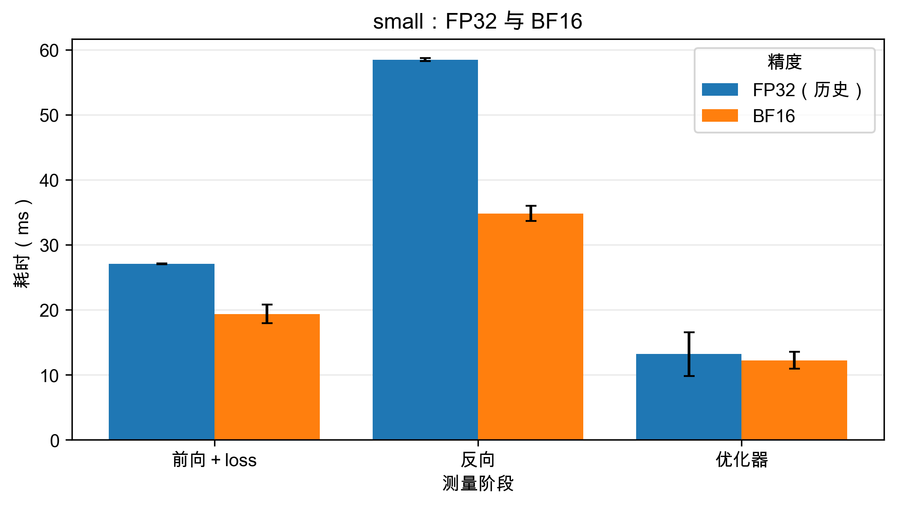
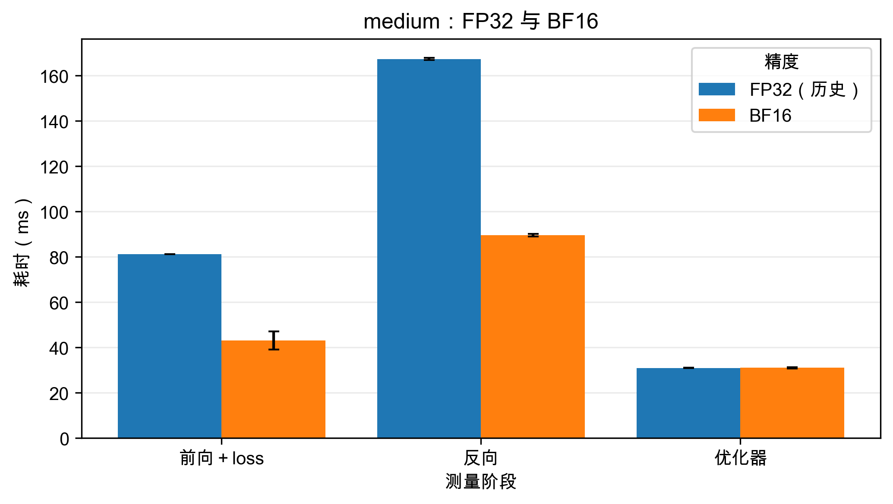

# 混合精度分阶段性能对照

2026-10-08 在 RTX 4090 上新增 small、medium 各一次 BF16 `train_stages` 实验，与 `outputs/benchmark/` 中对应的历史 FP32 测量比较。两次新实验均正常完成，未开启 Nsight 或 NVTX。

共用配置：batch=4、序列长度=512、词表=10000、SwiGLU、PreNorm、RoPE、lr=0.001；预热 5 次、正式测量 10 次。small 为 d_model=768、d_ff=3072、12 层、12 头；medium 为 d_model=1024、d_ff=4096、24 层、16 头。新实验参数仍为 FP32，开启 BF16 autocast，seed=0，matmul TF32=False，PyTorch 2.11.0+cu128。

前向列包含 loss。反向是单独围绕 `loss.backward()` 测得，未用两次总耗时相减。各阶段边界同步 CUDA；清空梯度不在三个阶段的计时内。这些是同步边界下的阶段耗时，不是纯 kernel 时间。

## 结果

时间为均值 ± step 间样本标准差，单位 ms；加速比 = FP32 均值 / BF16 均值。

| 模型 | 阶段 | 历史 FP32 | BF16 autocast | 加速比 | 耗时减少 |
| --- | --- | ---: | ---: | ---: | ---: |
| small | 前向＋loss | 27.04 ± 0.07 | 19.36 ± 1.43 | 1.40× | 28.4% |
| small | 反向 | 58.47 ± 0.23 | 34.81 ± 1.17 | 1.68× | 40.5% |
| small | 优化器 | 13.20 ± 3.37 | 12.22 ± 1.31 | 1.08× | 7.4% |
| medium | 前向＋loss | 81.18 ± 0.07 | 43.07 ± 3.98 | 1.89× | 47.0% |
| medium | 反向 | 167.38 ± 0.47 | 89.55 ± 0.55 | 1.87× | 46.5% |
| medium | 优化器 | 30.93 ± 0.08 | 31.01 ± 0.20 | 1.00× | -0.3% |

图中柱高是平均耗时，误差线是 step 间样本标准差，不是置信区间。

## 观察与解释

- small：前向约加速 1.40×，反向约加速 1.68×。前向与反向阶段均值之和约加速 1.58×；这个和不称作另测的整步总时间。
- medium：前向约加速 1.89×，反向约加速 1.87×。前向与反向阶段均值之和约加速 1.87×；这个和不称作另测的整步总时间。
- 从 small 到 medium，本轮观察到前向与反向的加速比均上升；优化器未显示稳定的加速收益。两种精度下优化器均处理 FP32 参数、梯度和动量，因而它没有直接获得低精度矩阵乘法的收益。small 的历史优化器标准差较大，不能把其均值的小幅下降解释为明确加速。

一种合理解释是：较大的矩阵乘法更容易充分使用 GPU，计算工作也更能摊薄 CPU 调度与启动开销，因此低精度矩阵运算的收益在 medium 上更明显；与此同时，FP32 归一化、loss、逐元素操作和转换开销仍在。这是根据计算结构与公开性能规律作出的解释，本轮没有采集 BF16 的逐 kernel 时间来确认各项贡献。参考 [NVIDIA 矩阵乘法性能说明](https://docs.nvidia.com/deeplearning/performance/dl-performance-matrix-multiplication/index.html)。

## 对照范围

本轮按选定范围只比较 small 与 medium。宽度和层数同时变化，所以结果是这两套配置的观察，不能单独归因于层数或保证加速比随所有模型规模单调增长，也未覆盖 Table 1 的 large、xl、10B。旧 FP32 结果未记录随机种子，本轮是沿用历史结果的对照；模型形状与已有配置字段已逐项核对一致。BF16 前向的标准差比旧 FP32 高，正式结论保留全部 10 次测量，不挑选最快 step。

原始日志、CSV、精确运行命令及执行信息在 `outputs/mixed_precision/`；输入文件 SHA256 在 `comparison_inputs.json`。运行 `uv run python report_mixed_precision.py` 可重新生成表格和图片，该命令不启动 GPU 测量。
