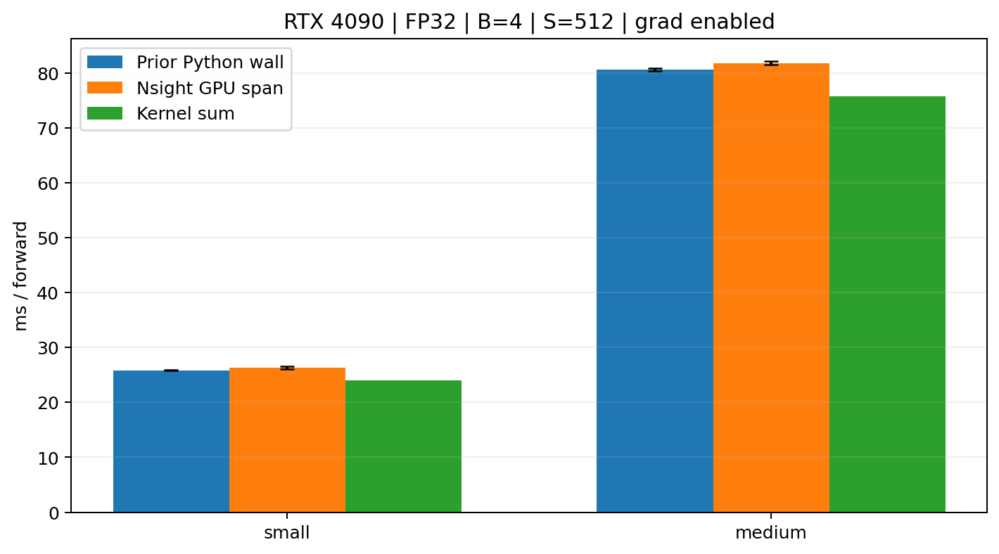
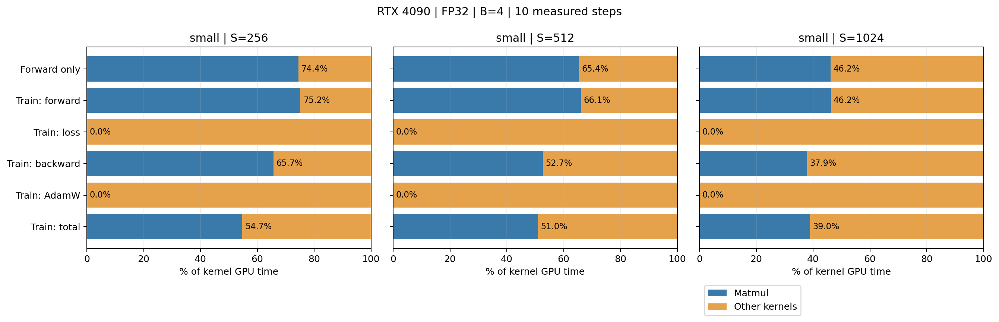
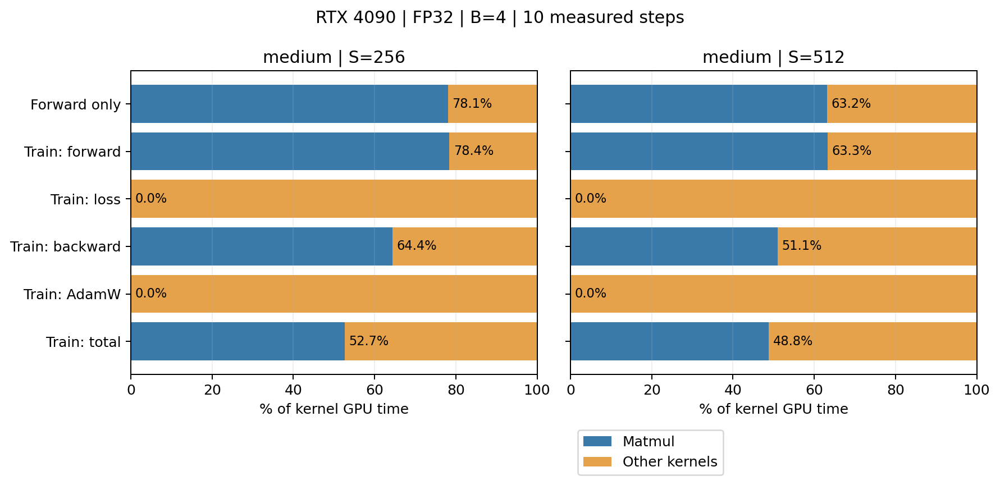
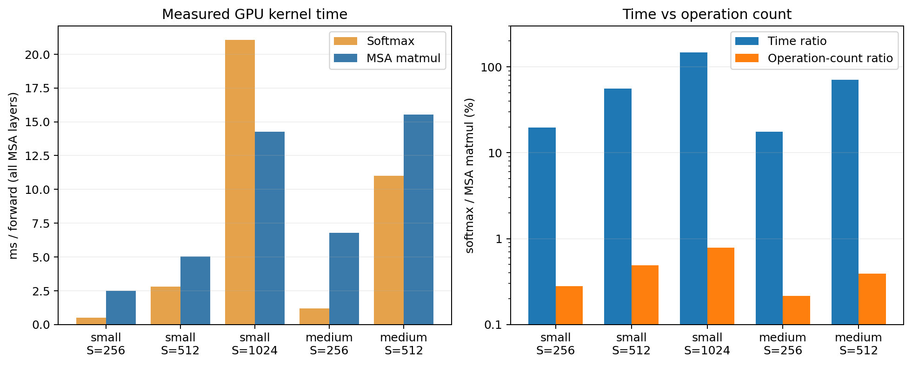

# Nsight Systems 实验报告

2026-10-08；RTX 4090 24 GiB。完成 **15 份正式 trace**、9 次容量探测；small 的三档长度为 256/512/1024，medium 的两档为 256/512。medium/1024 三种模式均实际 OOM；按本次选择保持 batch=4，因此 **medium 尚未满足作业要求的三档成功长度**，不把 OOM 当作第三档测量。

## 实验条件与时间口径

模型使用你自己的 A1 实现。small=(d=768,f=3072,L=12,H=12)，medium=(1024,4096,24,16)；V=10,000，B=4，FP32，pre-norm、SwiGLU、RoPE。warmup=5、正式 steps=10，逐配置独立进程、串行运行；梯度开启，前向模式与旧实验保持一致，因此其显存不能当作 no_grad 推理显存。没有固定正式实验的随机 seed，旧/新实验不保证权重逐值一致。

Python 3.12.14、PyTorch 2.11.0+cu128、CUDA 12.8、Nsight Systems 2025.1.1、驱动 580.105.08；matmul TF32=False，float32 matmul precision=highest。版本、模型及测速源码 SHA256 和标注校验见 [environment.json](../outputs/nsight_run/environment.json)、[instrumentation_validation.json](../outputs/nsight_run/instrumentation_validation.json)。

GPU span 是范围内第一个关联 GPU 操作开始到最后一个结束的跨度，包含中间空隙；kernel sum 是所有 kernel 持续时间之和，排除 GPU 空隙、CPU、同步等待和内存复制。Python wall 则还包含 CPU 发起操作和等待的经过时间；图中的它们是三个不同指标，不能相互替代。阶段没有额外插入同步，只有 step 边界同步；相邻阶段的 GPU span 不保证相加等于整步 span。[NVIDIA GPU projection 定义](https://docs.nvidia.com/nsight-systems/AnalysisGuide/index.html#nvtx-gpu-proj-sum-nvtx-gpu-projection-summary)。

**反向线程的归属：**本轮 PyTorch autograd 在工作线程发起反向 CUDA kernel，外部 backward 标签在主线程，因此官方 NVTX GPU projection 表没有覆盖这些反向事件。阶段与 total 使用同一进程内、各 CPU 阶段范围中的 CUDA launch 时间归属（逐事件匹配 correlationId），保留工作线程；这适用于本次串行单步脚本，没有按 GPU 时间是否重叠猜归属。全部 kernel 的名称、次数、累计时间与官方全量 kernel 表一致，主线程阶段的 GPU span 与官方 projection 一致；具体差异存于 *_analysis_validation.json。

采集只开启 CUDA/NVTX，measurement 范围排除初始化和 warm-up；attention 包含完整 MSA 的四次投影、RoPE、QKᵀ、mask、softmax、PV，attention_softmax 只包含手写 softmax 的 max/减/exp/sum/除。标签在测速脚本中临时包住原调用，退出后恢复；小规模 CUDA 输出和所有参数梯度加标签前后逐位相同，A1 算法文件没有修改。

## 容量边界

| model | mode | last_success_S | first_OOM_S | profile_peak_allocated_GiB | profile_peak_reserved_GiB |
| --- | --- | --- | --- | --- | --- |
| small | forward | 1024 | 2048 | 9.423 | 9.516 |
| small | forward_backward | 1024 | 2048 | 9.934 | 10.541 |
| small | train | 1024 | 2048 | 10.911 | 11.566 |
| medium | forward | 512 | 1024 | 10.335 | 10.623 |
| medium | forward_backward | 512 | 1024 | 10.572 | 10.998 |
| medium | train | 512 | 1024 | 13.730 | 14.205 |

长度按 2 倍增加至首个 OOM，small 从 1024 探至 2048，medium 在 1024 失败，512 的成功已有旧记录且本轮再次正式采集成功。表中 peak_allocated/peak_reserved 来自正式采集整个进程（包括初始化和预热）；二者不能相加，且不包含所有驱动/Profiler 开销，OOM 前峰值和异常栈另存在日志。

## (a) 前向时间及旧 Python 对照

| model | seq_len | prior_python_mean_ms | nsight_gpu_span_mean_ms | kernel_sum_mean_ms |
| --- | --- | --- | --- | --- |
| small | 256 | — | 21.616 | 10.774 |
| small | 512 | 25.853 | 26.335 | 24.048 |
| small | 1024 | — | 80.719 | 74.125 |
| medium | 256 | — | 42.821 | 31.596 |
| medium | 512 | 80.619 | 81.805 | 75.787 |

三组柱分别表示旧 Python wall、Nsight GPU span、kernel sum；Python 与 span 的误差线表示 10 步标准差，kernel sum 的图中没有误差线。只有 S=512 有旧的同配置对照；本轮没有额外重跑旧 Python 基线，完整 [forward_comparison.csv](../outputs/nsight_run/analysis/forward_comparison.csv) 还保留标准差及 profiled_python 列，后者是在 profiler 内顺带记录的时间。

## (b) 累计耗时最多的 kernel

| model | seq_len | forward_top_kernel | forward_calls_per_step | forward_kernel_percent | forward_backward_top_kernel | forward_backward_kernel_percent |
| --- | --- | --- | --- | --- | --- | --- |
| small | 256 | ampere_sgemm_128x64_tn | 85.000 | 68.981 | ampere_sgemm_128x64_tn | 21.741 |
| small | 512 | ampere_sgemm_128x64_tn | 84.000 | 55.341 | ampere_sgemm_128x64_tn | 16.915 |
| small | 1024 | ampere_sgemm_128x64_tn | 84.000 | 34.950 | vectorized / MulFunctor / tensor × tensor | 12.100 |
| medium | 256 | ampere_sgemm_128x64_tn | 169.000 | 74.751 | ampere_sgemm_128x64_tn | 25.244 |
| medium | 512 | ampere_sgemm_128x64_tn | 168.000 | 56.372 | ampere_sgemm_128x64_tn | 18.250 |

完整模板名和各项时间见 [top_kernels.csv](../outputs/nsight_run/analysis/top_kernels.csv)。这里按 10 步的 Total Time 排名，calls_per_step 是总调用数除以 10；已逐 kernel 验证每步调用数相同。矩阵乘法调用数包含库的实际 kernel 分派，不能用 kernel 名称个数代替算法层面的矩阵乘法次数。[NVIDIA 统计字段说明](https://docs.nvidia.com/nsight-systems/AnalysisGuide/index.html)。

## (c) 主要非矩阵乘法 kernel

| model | seq_len | kernel | gpu_ms_per_forward | percent_forward_kernel_time | calls_per_forward | observed_range |
| --- | --- | --- | --- | --- | --- | --- |
| small | 256 | elementwise / MulFunctor / tensor × tensor | 0.441 | 4.094 | 121.000 | 多个区域共用 |
| small | 256 | vectorized / MulFunctor / tensor × tensor | 0.328 | 3.048 | 24.000 | MSA 外 |
| small | 256 | vectorized / CUDAFunctor_add | 0.264 | 2.453 | 72.000 | 多个区域共用 |
| small | 256 | elementwise / direct_copy_kernel_cuda | 0.213 | 1.978 | 48.000 | MSA 内、softmax 外 |
| small | 256 | elementwise / DivFunctor | 0.201 | 1.868 | 37.000 | 多个区域共用 |
| small | 512 | vectorized / MulFunctor / scalar × tensor | 1.243 | 5.168 | 12.000 | MSA 内、softmax 外 |
| small | 512 | vectorized / MulFunctor / tensor × tensor | 1.060 | 4.408 | 24.000 | MSA 外 |
| small | 512 | vectorized / exp_kernel_cuda | 0.944 | 3.925 | 12.000 | softmax 内 |
| small | 512 | elementwise / DivFunctor | 0.822 | 3.416 | 37.000 | 多个区域共用 |
| small | 512 | elementwise / CUDAFunctor_add | 0.723 | 3.006 | 12.000 | softmax 内 |
| small | 1024 | elementwise / masked_fill_kernel | 5.209 | 7.027 | 12.000 | MSA 内、softmax 外 |
| small | 1024 | vectorized / MulFunctor / scalar × tensor | 5.200 | 7.016 | 12.000 | MSA 内、softmax 外 |
| small | 1024 | vectorized / exp_kernel_cuda | 5.200 | 7.015 | 12.000 | softmax 内 |
| small | 1024 | elementwise / DivFunctor | 4.897 | 6.607 | 37.000 | 多个区域共用 |
| small | 1024 | elementwise / CUDAFunctor_add | 4.665 | 6.294 | 12.000 | softmax 内 |
| medium | 256 | elementwise / MulFunctor / tensor × tensor | 1.010 | 3.198 | 241.000 | 多个区域共用 |
| medium | 256 | vectorized / MulFunctor / tensor × tensor | 0.965 | 3.054 | 48.000 | MSA 外 |
| medium | 256 | vectorized / CUDAFunctor_add | 0.657 | 2.079 | 144.000 | 多个区域共用 |
| medium | 256 | vectorized / sigmoid_kernel_cuda | 0.574 | 1.815 | 24.000 | MSA 外 |
| medium | 256 | vectorized / MulFunctor / scalar × tensor | 0.554 | 1.754 | 24.000 | MSA 内、softmax 外 |
| medium | 512 | vectorized / MulFunctor / tensor × tensor | 3.827 | 5.050 | 48.000 | MSA 外 |
| medium | 512 | vectorized / exp_kernel_cuda | 3.515 | 4.638 | 24.000 | softmax 内 |
| medium | 512 | vectorized / MulFunctor / scalar × tensor | 3.377 | 4.456 | 24.000 | MSA 内、softmax 外 |
| medium | 512 | elementwise / DivFunctor | 3.091 | 4.079 | 73.000 | 多个区域共用 |
| medium | 512 | elementwise / masked_fill_kernel | 3.087 | 4.074 | 24.000 | MSA 内、softmax 外 |

kernel 名在本表简写，完整 C++ 模板名保存在 [nonmatmul_kernels.csv](../outputs/nsight_run/analysis/nonmatmul_kernels.csv) 和 [kernel_observations.csv](../outputs/nsight_plan/kernel_observations.csv)。归属由 CUDA launch 的 correlationId 关联到 NVTX 范围确定，不能只凭 vectorized_elementwise 这个通用前缀判断。

attention_softmax 中 exp/div/归约是 softmax 的组成部分；MSA 内、softmax 外的 scalar × tensor MulFunctor 与注意力缩放相符。MSA 外的 sigmoid 和每层两次 tensor × tensor 乘法与 SwiGLU 的 sigmoid、SiLU 乘法、门控乘法相符；后者依据标签排除和源码调用模式推断，没有额外给 FFN 打标签。其他共享逐元素 kernel 还用于 RoPE、RMSNorm 与残差，不能一概归入 FFN。[PyTorch 通用逐元素实现](https://github.com/pytorch/pytorch/blob/main/aten/src/ATen/native/cuda/CUDALoops.cuh)。

## (d) 训练阶段及整步矩阵乘法占比

蓝色为矩阵乘法，橙色为该范围内其他 kernel；百分比的分母都是该行全部 kernel 的累计 GPU 时间。Forward only 是独立前向采集，Train: forward/loss/backward/AdamW 是训练的各阶段，Train: total 是整步；它们是不同范围，不能把各阶段百分比相加。阶段实际毫秒数与完整占比表见 [stage_observations.csv](../outputs/nsight_plan/stage_observations.csv)。

## (e) 注意力 softmax 与矩阵乘法

| model | seq_len | softmax_gpu_mean_ms | msa_matmul_gpu_mean_ms | time_ratio_% | operation_ratio_% |
| --- | --- | --- | --- | --- | --- |
| small | 256 | 0.490 | 2.498 | 19.634 | 0.279 |
| small | 512 | 2.796 | 5.038 | 55.486 | 0.488 |
| small | 1024 | 21.045 | 14.267 | 147.504 | 0.781 |
| medium | 256 | 1.194 | 6.792 | 17.585 | 0.217 |
| medium | 512 | 10.992 | 15.548 | 70.695 | 0.390 |

左图是一次前向所有 MSA 层的 kernel 累计时间；右图蓝柱为 softmax/矩阵乘法时间比，橙柱为对应运算量比，纵轴为对数刻度，以便同时看清相差两个数量级的比值。完整 MSA 的矩阵乘法 FLOPs 为 L(8Bsd²+4Bs²d)，包括 QKV/输出投影和 QKᵀ、PV；没有把整个 attention 的 span 当成矩阵乘法时间。

手写 softmax 每行长度 s：max 比较 s−1 次、减法 s 次、exp s 次、求和 s−1 次、除法 s 次，按每项一次标量操作计为 5s−2，总量 LBHs(5s−2)。max 比较严格说不属于 FLOP，exp/div 也不等于一条硬件指令，因此这里明示为近似运算量约定；若只统计加减乘除，softmax 的比值还会更低。这不影响 softmax 时间比例显著大于简单运算量比例的观察；内存读写、归约与多个 kernel 发起成本是合理解释，本次未单独测带宽或指令吞吐；[FlashAttention 论文](https://arxiv.org/abs/2205.14135)也强调应考虑注意力的内存访问成本，而不只看 FLOPs。

## 每个配置的中文答题记录

### small / S=256

**(a)** 前向 GPU 执行跨度为 21.62 ms，kernel 累计时间为 10.77 ms。该长度没有同配置的旧 Python 结果。

**(b)** 前向累计时间最多的是 ampere_sgemm_128x64_tn，每次前向调用 85 次，占 kernel 时间 69.0%。前向加反向的榜首为 ampere_sgemm_128x64_tn，名称相同。

**(c)** 主要非矩阵乘法 kernel 包括 elementwise / MulFunctor / tensor × tensor（4.1%）、vectorized / MulFunctor / tensor × tensor（3.0%）、vectorized / CUDAFunctor_add（2.5%）；具体标签归属见 (c) 表。

**(d)** 完整训练的矩阵乘法占比为 54.7%，前向为 74.4%，变化 -19.7 个百分点。优化器阶段没有矩阵乘法，反向也增加了逐元素与归约等 kernel。

**(e)** 全部 MSA 层的 softmax 与矩阵乘法分别耗时 0.490、2.498 ms，时间比为 19.63%。按本文标量运算约定，运算量比仅 0.28%。

### small / S=512

**(a)** 前向 GPU 执行跨度为 26.34 ms，kernel 累计时间为 24.05 ms。旧 Python 测得 25.85 ms，两者相差 +1.9%。

**(b)** 前向累计时间最多的是 ampere_sgemm_128x64_tn，每次前向调用 84 次，占 kernel 时间 55.3%。前向加反向的榜首为 ampere_sgemm_128x64_tn，名称相同。

**(c)** 主要非矩阵乘法 kernel 包括 vectorized / MulFunctor / scalar × tensor（5.2%）、vectorized / MulFunctor / tensor × tensor（4.4%）、vectorized / exp_kernel_cuda（3.9%）；具体标签归属见 (c) 表。

**(d)** 完整训练的矩阵乘法占比为 51.0%，前向为 65.4%，变化 -14.4 个百分点。优化器阶段没有矩阵乘法，反向也增加了逐元素与归约等 kernel。

**(e)** 全部 MSA 层的 softmax 与矩阵乘法分别耗时 2.796、5.038 ms，时间比为 55.49%。按本文标量运算约定，运算量比仅 0.49%。

### small / S=1024

**(a)** 前向 GPU 执行跨度为 80.72 ms，kernel 累计时间为 74.12 ms。该长度没有同配置的旧 Python 结果。

**(b)** 前向累计时间最多的是 ampere_sgemm_128x64_tn，每次前向调用 84 次，占 kernel 时间 35.0%。前向加反向的榜首为 void at::native::vectorized_elementwise_kernel<(int)4, at::native::BinaryFunctor<float, float, float, at::native::binary_internal::MulFunctor<float>>, std::array<char *, (unsigned long)3>>(int, T2, T3)，与前向不同。

**(c)** 主要非矩阵乘法 kernel 包括 elementwise / masked_fill_kernel（7.0%）、vectorized / MulFunctor / scalar × tensor（7.0%）、vectorized / exp_kernel_cuda（7.0%）；具体标签归属见 (c) 表。

**(d)** 完整训练的矩阵乘法占比为 39.0%，前向为 46.2%，变化 -7.2 个百分点。优化器阶段没有矩阵乘法，反向也增加了逐元素与归约等 kernel。

**(e)** 全部 MSA 层的 softmax 与矩阵乘法分别耗时 21.045、14.267 ms，时间比为 147.50%。按本文标量运算约定，运算量比仅 0.78%。

### medium / S=256

**(a)** 前向 GPU 执行跨度为 42.82 ms，kernel 累计时间为 31.60 ms。该长度没有同配置的旧 Python 结果。

**(b)** 前向累计时间最多的是 ampere_sgemm_128x64_tn，每次前向调用 169 次，占 kernel 时间 74.8%。前向加反向的榜首为 ampere_sgemm_128x64_tn，名称相同。

**(c)** 主要非矩阵乘法 kernel 包括 elementwise / MulFunctor / tensor × tensor（3.2%）、vectorized / MulFunctor / tensor × tensor（3.1%）、vectorized / CUDAFunctor_add（2.1%）；具体标签归属见 (c) 表。

**(d)** 完整训练的矩阵乘法占比为 52.7%，前向为 78.1%，变化 -25.4 个百分点。优化器阶段没有矩阵乘法，反向也增加了逐元素与归约等 kernel。

**(e)** 全部 MSA 层的 softmax 与矩阵乘法分别耗时 1.194、6.792 ms，时间比为 17.58%。按本文标量运算约定，运算量比仅 0.22%。

### medium / S=512

**(a)** 前向 GPU 执行跨度为 81.81 ms，kernel 累计时间为 75.79 ms。旧 Python 测得 80.62 ms，两者相差 +1.5%。

**(b)** 前向累计时间最多的是 ampere_sgemm_128x64_tn，每次前向调用 168 次，占 kernel 时间 56.4%。前向加反向的榜首为 ampere_sgemm_128x64_tn，名称相同。

**(c)** 主要非矩阵乘法 kernel 包括 vectorized / MulFunctor / tensor × tensor（5.1%）、vectorized / exp_kernel_cuda（4.6%）、vectorized / MulFunctor / scalar × tensor（4.5%）；具体标签归属见 (c) 表。

**(d)** 完整训练的矩阵乘法占比为 48.8%，前向为 63.2%，变化 -14.3 个百分点。优化器阶段没有矩阵乘法，反向也增加了逐元素与归约等 kernel。

**(e)** 全部 MSA 层的 softmax 与矩阵乘法分别耗时 10.992、15.548 ms，时间比为 70.70%。按本文标量运算约定，运算量比仅 0.39%。

## 原始记录与复现

- [运行清单](../outputs/nsight_plan/experiment_manifest.csv)、[容量探测清单](../outputs/nsight_plan/capacity_probe_manifest.csv)、[容量结果](../outputs/nsight_plan/capacity_results.csv)。
- [运行日志目录](../outputs/nsight_run/logs/)、[全部 CSV/图表](../outputs/nsight_run/analysis/)。每份 trace 的 *_validation.json 记录范围数量，*_analysis_validation.json 全量核对官方统计；*_events.csv 保留逐事件关联。
- 表格同时导出 CSV、LaTeX、Typst；图同时导出 PNG、PDF。

本轮的实验脚本为 [run_nsight_experiments.py](../run_nsight_experiments.py)，分析为 [analyze_nsight.py](../analyze_nsight.py)，报告与图表为 [report_nsight.py](../report_nsight.py)。GPU 采集已完成，不要直接重跑执行脚本覆盖现有文件；重新生成分析和报告可在 A2 目录执行 `uv run python analyze_nsight.py`、`uv run python report_nsight.py`。

正式 trace：

- [small_s512_forward.nsys-rep](../outputs/nsight_run/profiles/small_s512_forward.nsys-rep)
- [small_s512_forward_backward.nsys-rep](../outputs/nsight_run/profiles/small_s512_forward_backward.nsys-rep)
- [small_s512_train.nsys-rep](../outputs/nsight_run/profiles/small_s512_train.nsys-rep)
- [small_s256_forward.nsys-rep](../outputs/nsight_run/profiles/small_s256_forward.nsys-rep)
- [small_s256_forward_backward.nsys-rep](../outputs/nsight_run/profiles/small_s256_forward_backward.nsys-rep)
- [small_s256_train.nsys-rep](../outputs/nsight_run/profiles/small_s256_train.nsys-rep)
- [small_s1024_forward.nsys-rep](../outputs/nsight_run/profiles/small_s1024_forward.nsys-rep)
- [small_s1024_forward_backward.nsys-rep](../outputs/nsight_run/profiles/small_s1024_forward_backward.nsys-rep)
- [small_s1024_train.nsys-rep](../outputs/nsight_run/profiles/small_s1024_train.nsys-rep)
- [medium_s512_forward.nsys-rep](../outputs/nsight_run/profiles/medium_s512_forward.nsys-rep)
- [medium_s512_forward_backward.nsys-rep](../outputs/nsight_run/profiles/medium_s512_forward_backward.nsys-rep)
- [medium_s512_train.nsys-rep](../outputs/nsight_run/profiles/medium_s512_train.nsys-rep)
- [medium_s256_forward.nsys-rep](../outputs/nsight_run/profiles/medium_s256_forward.nsys-rep)
- [medium_s256_forward_backward.nsys-rep](../outputs/nsight_run/profiles/medium_s256_forward_backward.nsys-rep)
- [medium_s256_train.nsys-rep](../outputs/nsight_run/profiles/medium_s256_train.nsys-rep)

有。这组作业是在让你从**“模型需要多少计算”走到“实际运行慢在哪里，以及应该优化什么”**。结合[这次实测报告](/Users/mileszhu/Documents/个人项目/cs336/assignment2-systems/docs/nsight_report.md)，五部分可以这样理解。

1. **(a) 先确认：我们的计时是否可信？**

   small/512 的旧 Python 计时是 **25.85 ms**，Nsight 的 GPU 执行跨度是 **26.34 ms**，大体一致。这支持之前采用同步的计时方法是合理的。

   但“所有 kernel 的时间加起来”和“完成整个前向需要的时间”仍有区别。例如 small/256：

   - kernel 累计执行：**10.77 ms**
   - GPU 执行跨度：**21.62 ms**

   中间还有内存复制和 kernel 之间的空隙。这个配置的复制耗时很小，因此大部分差值是执行间隙；**这提示小规模任务可能受到 CPU 提交、调度速度的影响**。即使每个 kernel 都很快，整体仍可能被大量零碎调用拖慢。

2. **(b) 用 kernel 找回计算图，判断瓶颈是否随场景变化。**

   small/512 的主要 kernel 是 `ampere_sgemm_128x64_tn`，一次前向调用 **84 次**。我们核对了，其中：

   - 注意力内部 **48 次**：每层四个投影 × 12 层。
   - 注意力外部 **36 次**：每层三个 FFN 投影 × 12 层。

   这就把 profiler 的统计接回了你自己写的模型。QKᵀ、PV、LM head 的矩阵乘法还会使用其他 kernel 变体。

   更有意思的是：**small/1024 加上反向后，累计时间最多的 kernel 变成了逐元素乘法。**这说明优化对象会随序列长度、前向或训练模式变化。研究训练性能时，需要观察完整训练的工作负载。

3. **(c) FLOPs 少的操作，也可能很耗时。**

   这里要补上你之前资源计算中没有包含的一项：**搬运数据的成本。**

   举个小例子，逐元素计算 `c = a * b`：对于 FP32，从逻辑上要读取两个数，共 8 字节，再写出 4 字节结果，却只完成一次乘法。矩阵乘法则可以让同一块输入数据参与很多次乘加，数据复用程度更高。

   因此，逐元素操作和归约虽然计算次数少，仍可能花很多时间在读写、归约协调和执行开销上。NVIDIA 的性能指南也将这些操作列为通常容易受内存带宽限制的类别。[参考说明](https://docs.nvidia.com/deeplearning/performance/dl-performance-gpu-background/index.html#dnn-operation-categories)

   **由此产生的优化思路是融合操作。**例如把几次连续的逐元素计算放进一个 kernel，让中间结果留在寄存器中，可以减少中间张量的写出、重新读取和 kernel 调用。

4. **(d) 训练增加了哪些成本？还要分清绝对时间和占比。**

   small/512 的矩阵乘法时间占比，从独立前向的 **65.4%** 降到完整训练的 **51.0%**。因为训练还加入了逐元素梯度计算、归约，以及 AdamW 的参数和动量更新。

   AdamW 的结果尤其有启发性：small 在长度 256、512、1024 下，优化器的 kernel 时间都约为 **8.53 ms**。

   原因很自然：**AdamW 处理的是参数及其梯度，工作量主要由参数数量决定。**序列变长会增加前向和反向工作，但参数数量没有变化，所以更新这些参数的工作量基本不变。

   于是 AdamW 在整步 kernel 时间中的占比，从约 **20% 降到 3.6%**，但它的绝对耗时没有变快。**看到某部分占比下降时，要同时检查它自己的时间是否下降。**

5. **(e) 这部分直接解释了为什么值得学习 FlashAttention。**

   比较 small 的两个长度，下面都是一次前向中全部注意力层的累计 kernel 时间：

   | 序列长度 | softmax | 注意力矩阵乘法 |
   |---|---:|---:|
   | 512 | 2.80 ms | 5.04 ms |
   | 1024 | 21.05 ms | 14.27 ms |

   到 1024 时，**softmax 的时间已经超过注意力矩阵乘法**，但按报告里的近似运算计数，它的运算量只有后者的约 **0.78%**。

   结合当前实现，合理的解释是：手写 softmax 分成 max、减法、exp、sum、除法等操作，反复处理很大的注意力张量；读写、归约和这些操作的执行成本都需要考虑。具体各项贡献还需要进一步测量。

   同时，注意力矩阵的大小随 \(s^2\) 增长。以 small、batch=4 为例，单层一张 FP32 注意力矩阵在长度 1024 时约 **192 MiB**，到 2048 就是 **768 MiB**；多层和反向保存的张量会进一步增加显存需求。

   **FlashAttention 把注意力计算按块组织，减少大中间矩阵在显存中的存储和反复读写。**它保持标准注意力的数学目标，通过改变计算组织来改善速度和显存使用。你这次测到的 softmax 耗时和 OOM 边界，正好让这个设计动机变得具体了。[原论文](https://arxiv.org/abs/2205.14135)