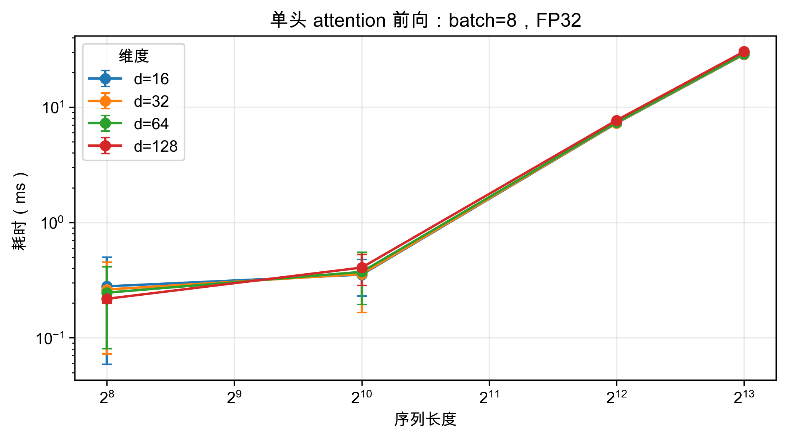
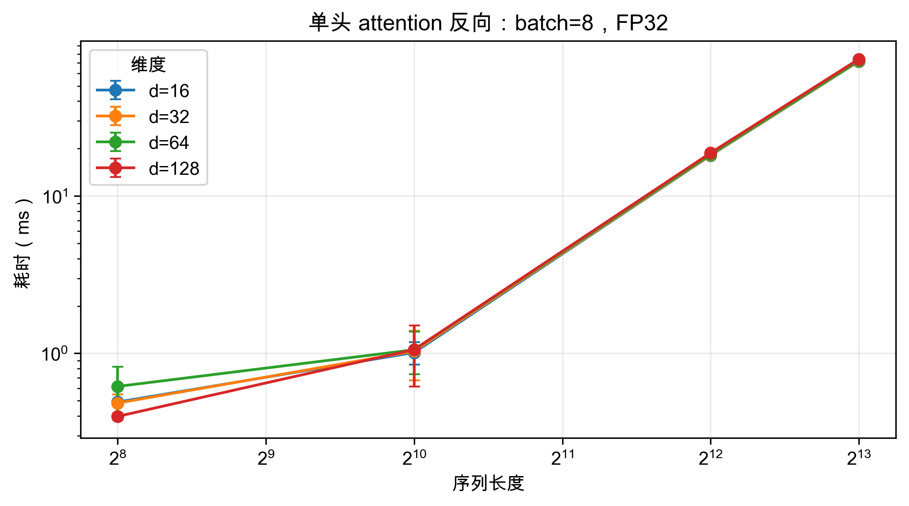
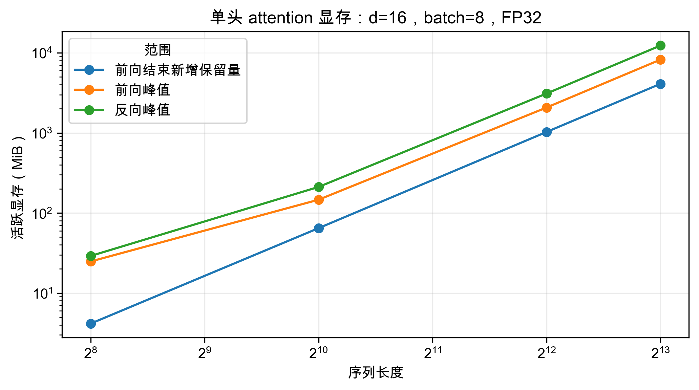

# PyTorch 单头 attention 测量报告

本轮使用自己的 A1 attention，在 NVIDIA GeForce RTX 4090 上完成题目全部 20 组配置：**16 组成功、4 组 OOM**。四种维度都能运行到长度 8192；长度 16384 全部在预热时 OOM。另对最小失败配置进行一次独立诊断，确认失败发生在前向 softmax 的 `torch.exp`，尚未进入反向。

## 配置与口径

batch=8；d∈{16,32,64,128}；s∈{256,1024,4096,8192,16384}；FP32；不加 causal mask；无 Q/K/V 投影和多头拼接。PyTorch 2.11.0+cu128，CUDA 12.8，TF32 matmul=False。每组预热 5 次，成功配置分别采集 100 次前向和反向，每次调用前后同步 CUDA。输入和外部输出梯度提前生成，前向保留 autograd；每轮创建新计算图并清空 Q/K/V 梯度，不含 loss 和优化器。

时间包含 Python 调用与同步等待，是平均值 ± **总体标准差**，不是纯 kernel 时间或置信区间。显存使用 PyTorch allocator 的活跃分配量，峰值包含基线；反向前显存是前向完成时的活跃量，不能当作执行峰值。[memory_allocated](https://docs.pytorch.org/docs/2.11/generated/torch.cuda.memory.memory_allocated.html)。

## 完整结果

| d | s | 前向 ms | 反向 ms | 反向前 GiB | 前向峰值 GiB | 反向峰值 GiB | 状态 |
| ---: | ---: | --- | --- | ---: | ---: | ---: | --- |
| 16 | 256 | 0.279 ± 0.221 | 0.490 ± 0.113 | 0.020 | 0.024 | 0.028 | 成功 |
| 16 | 1024 | 0.353 ± 0.123 | 1.013 ± 0.166 | 0.081 | 0.143 | 0.206 | 成功 |
| 16 | 4096 | 7.248 ± 0.087 | 18.110 ± 0.116 | 1.026 | 2.024 | 3.028 | 成功 |
| 16 | 8192 | 28.612 ± 0.081 | 71.705 ± 0.234 | 4.036 | 8.032 | 12.040 | 成功 |
| 16 | 16384 | 未测量 | 未测量 | — | — | — | OOM（warmup） |
| 32 | 256 | 0.262 ± 0.190 | 0.483 ± 0.065 | 0.021 | 0.025 | 0.029 | 成功 |
| 32 | 1024 | 0.357 ± 0.192 | 1.033 ± 0.360 | 0.083 | 0.145 | 0.209 | 成功 |
| 32 | 4096 | 7.291 ± 0.081 | 18.190 ± 0.144 | 1.036 | 2.032 | 3.040 | 成功 |
| 32 | 8192 | 28.757 ± 0.048 | 71.984 ± 0.124 | 4.056 | 8.048 | 12.063 | 成功 |
| 32 | 16384 | 未测量 | 未测量 | — | — | — | OOM（warmup） |
| 64 | 256 | 0.246 ± 0.166 | 0.616 ± 0.206 | 0.022 | 0.026 | 0.031 | 成功 |
| 64 | 1024 | 0.373 ± 0.179 | 1.054 ± 0.319 | 0.088 | 0.149 | 0.215 | 成功 |
| 64 | 4096 | 7.357 ± 0.091 | 18.338 ± 0.131 | 1.055 | 2.047 | 3.063 | 成功 |
| 64 | 8192 | 28.967 ± 0.121 | 72.398 ± 0.100 | 4.095 | 8.079 | 12.110 | 成功 |
| 64 | 16384 | 未测量 | 未测量 | — | — | — | OOM（warmup） |
| 128 | 256 | 0.218 ± 0.017 | 0.398 ± 0.006 | 0.025 | 0.028 | 0.033 | 成功 |
| 128 | 1024 | 0.406 ± 0.122 | 1.057 ± 0.442 | 0.098 | 0.157 | 0.227 | 成功 |
| 128 | 4096 | 7.691 ± 0.070 | 18.779 ± 0.118 | 1.094 | 2.079 | 3.110 | 成功 |
| 128 | 8192 | 30.310 ± 0.039 | 74.062 ± 0.065 | 4.173 | 8.142 | 12.204 | 成功 |
| 128 | 16384 | 未测量 | 未测量 | — | — | — | OOM（warmup） |

OOM 发生于预热，所以没有填入虚假的 100 次测量均值或完成前向后的显存。边界仅限本轮离散配置：最长成功长度 8192，最短失败长度 16384，没有测定二者之间的精确临界值。

显存图中“前向结束新增保留量”减去了 Q/K/V、外部输出梯度与其他常驻分配的基线；两条峰值线保留基线。因此图中比较的是三种明确不同的口径，不应把前向新增保留量解释为总显存。

## 最小 OOM 配置：从张量形状开始计算

采用 **B=8、s=16384、d=16、FP32**，单位 GiB=2³⁰ 字节，MiB=2²⁰ 字节。

1. Q/K/V 各为 `(B,s,d)`：三份共 `3×8×16384×16×4` = **24.0 MiB**。外部输出梯度和输出各 **8.0 MiB**。
2. 分数 `QKᵀ`、减最大值后的分数、指数矩阵和概率矩阵都为 `(B,s,s)`。**每一张**大小 `4×8×16384²` = **8.0 GiB**。
3. 当前手写 softmax 为反向额外保存指数矩阵、概率矩阵，合计 **16.0 GiB**；行和与最大值索引合计 `12Bs` = **1.5 MiB**。Q/K/V 以原存储的引用保存，不重复计分配。
4. 因而，假如前向能够完成，脚本反向前的主要张量总量约为 `20Bsd + 8Bs² + 12Bs` = **16.041 GiB**。这个数还没有包含库工作空间和 allocator 对齐。
5. 实际前向在创建指数矩阵时已经失败：当时输入分数和减最大值后的分数仍活跃，占约 **16.0 GiB**；再申请一张 **8.0 GiB** 指数矩阵，将使这三份矩阵达到 **24.0 GiB**，加上输入和其他分配后无法放入本卡。诊断记录的已分配峰值为 **16.041 GiB**，错误要求再申请 8 GiB，报告剩余仅 7.00 GiB。这是前向执行峰值造成的失败，16 GiB 的保存量估算并不能保证前向能够完成。

若继续执行到 softmax 除法，当前局部变量还可能同时持有第四张概率矩阵，二次项达到约 **32.0 GiB**；本轮实际没有执行到这个位置。诊断的 [.pickle](../outputs/pytorch_attention/oom_d16_s16384.pickle) 可在 [memory_viz](https://pytorch.org/memory_viz) 打开，错误与调用栈保存在 [diagnostic.json](../outputs/pytorch_attention/oom_d16_s16384.diagnostic.json)。

## 结果解释与作业回答

反向需要保存的主要张量是两张 `(B,s,s)` 矩阵，因此固定 batch 时按 **O(s²)** 增长。d=16 时，长度从 4096 翻倍到 8192，前向新增保留量从 1026.375 MiB 增至 4100.750 MiB，约 **4.00 倍**；前向与反向耗时分别增为 **3.95、3.96 倍**。全部成功配置的前向新增保留量与逐项公式 `4Bsd + 8Bs² + 12Bs` 的最大差值为 0.000000 MiB，支持这里的保存量核算。

在长度 8192 下，维度从 16 增至 128，主要矩阵乘法 FLOPs 增加 8 倍，但前向与反向耗时仅增为 **1.06、1.03 倍**。这说明本轮耗时对序列长度更敏感；各维度处理的注意力矩阵大小相同，对这些 `(B,s,s)` 张量的逐元素运算和读写量不会随 d 增加。它支持“长序列的 s² 张量与数据搬运是主要压力”的判断，尚未通过 kernel profiler 精确划分各操作占比。要消除完整 s² 中间矩阵的保存成本，可以使用分块的 FlashAttention：在片上完成块内计算与在线 softmax，反向按需重算，而不是把完整矩阵一直存于显存。[FlashAttention 论文](https://arxiv.org/pdf/2205.14135#page=2)。仅降低精度可以减少每个元素的字节数，仍保留 s² 的增长。

## 复核与复现

原始记录：[CSV](../outputs/pytorch_attention/attention.csv)、[JSON](../outputs/pytorch_attention/attention.json)；较窄的报告表：[CSV](../outputs/pytorch_attention/summary.csv)、[LaTeX](../outputs/pytorch_attention/summary.tex)、[Typst](../outputs/pytorch_attention/summary.typ)。正式实验与诊断都正常退出（诊断捕获并记录预期 OOM），输入配置、100 个原始样本的均值/标准差、显存公式以及下载文件 SHA256 已核对。执行记录和源码快照位于 [execution.json](../outputs/pytorch_attention/execution.json) 与 `outputs/pytorch_attention/source_snapshot/`。

仅重建报告：在 assignment2-systems 中运行 `uv run python report_attention.py`。重新做正式实验：在 GPU 服务器运行 `uv run python -m cs336_systems.benchmark_attention`。本报告没有用诊断或此前 3 步检查的耗时替代正式数据。
