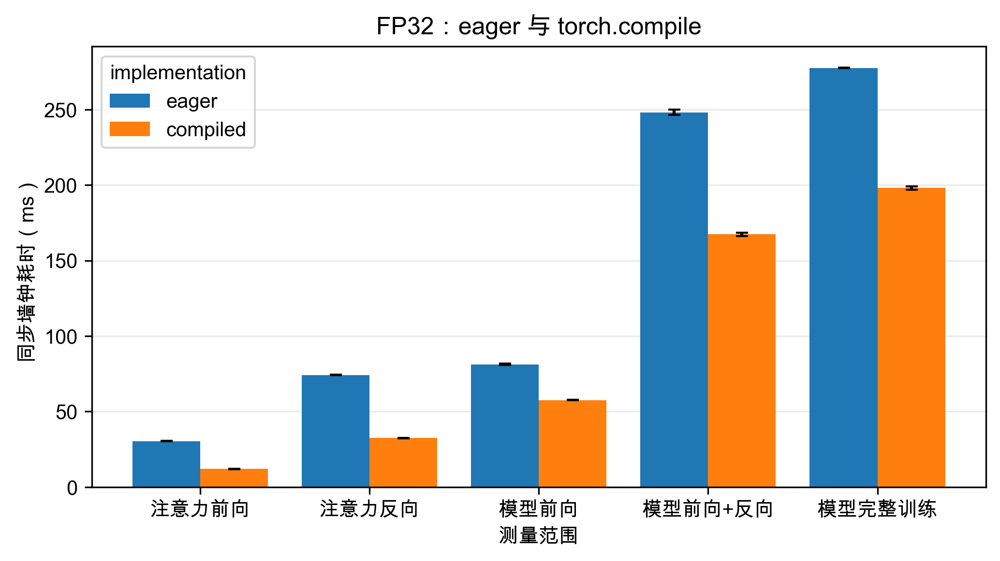
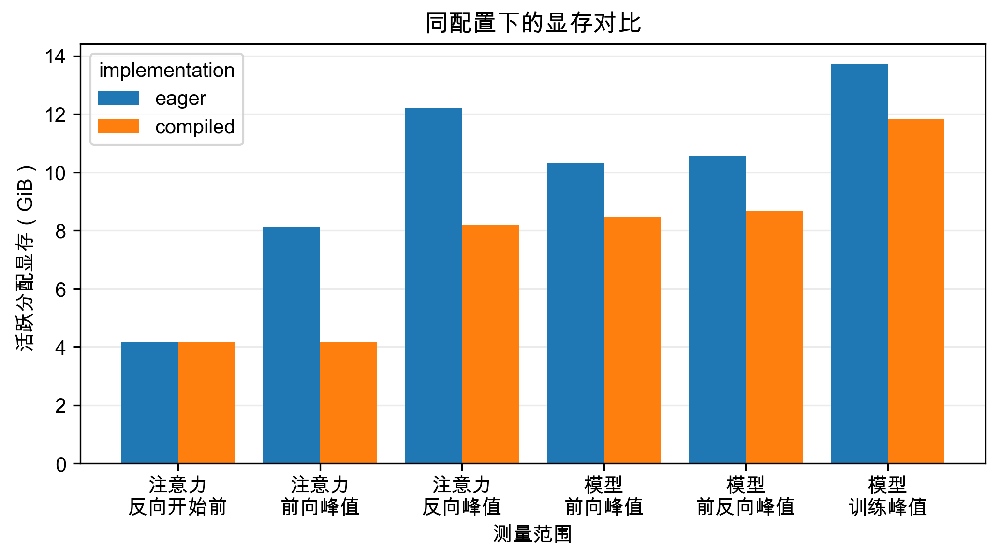

# Torch Compile 对照实验

## 范围与测量方法

本次按选定方案完成 8 组对照：单头注意力 eager/compiled 各一次；medium Transformer 的前向、前向+反向、完整训练步骤，各测 eager/compiled。原题 (a) 要求覆盖前一题全部注意力配置，本次只选了 d=128、s=8192 这一代表性配置，不能据此声称完成整个配置扫描。

- 环境：NVIDIA GeForce RTX 4090；PyTorch 2.11.0+cu128；CUDA 12.8。
- 注意力：B=8、s=8192、d=128，FP32，无 causal mask；前向和反向各 100 个样本。反向使用预先生成的外部输出梯度，每轮清除 Q/K/V 梯度，重新构建计算图。
- Transformer：medium，B=4、s=512、d_model=1024、d_ff=4096、24 层、16 头、词表 10000；pre-norm、SwiGLU、RoPE(θ=10000)，自写 AdamW(lr=0.001)。每组 10 个样本。前向仍开启 autograd，与之前的基线一致。
- 所有组 seed=0，FP32，TF32 关闭。eager 与 compiled 都重新测量，采用相同初始化与输入。各组先独立执行一次，再预热 5 次，最后计时；完整训练两侧执行相同次数的参数更新。
- 编译范围：`torch.compile(attention, backend="inductor", mode="default")` 或 `torch.compile(model, ...)`；loss 和 optimizer 不编译。每次计时调用前后同步 CUDA，测 CPU/GPU 同步墙钟时间；未开启 Nsight、NVTX 或显存历史采集。
- 表中 ± 为标准差：注意力使用总体标准差，Transformer 沿用脚本中的样本标准差。加速比=eager 平均耗时/compiled 平均耗时。

首次调用会触发延迟编译，所以首次执行与正式样本分开记录；默认 Inductor 缓存可能被正确性检查或其他进程复用，首次执行数值不是纯编译耗时，也不是清空缓存后的冷启动编译耗时。参见 [PyTorch compile 文档](https://docs.pytorch.org/docs/2.11/generated/torch.compile.html) 与 [官方教程的首次执行说明](https://docs.pytorch.org/tutorials/intermediate/torch_compile_tutorial.html)。

## 正确性核对

在两组正式形状上，以同一模型/输入比较 eager 和 compiled。注意力输出最大绝对误差 7.823e-08，Q/K/V 梯度最大误差 1.565e-07；medium logits 最大误差 3.099e-06，loss 误差 0.000e+00，全部 219 个参数张量的梯度最大误差 2.561e-09。输出采用 rtol=1e-4、atol=1e-5，梯度采用 rtol=1e-3、atol=1e-6，检查全部通过。正式 compiled 结果均记录到编译图，graph break 为 0。

## 稳态耗时

| 测量范围 | eager（ms） | compiled（ms） | 加速比 |
| --- | --- | --- | --- |
| 注意力前向 | 30.440 ± 0.092 | 12.052 ± 0.127 | 2.53× |
| 注意力反向 | 74.218 ± 0.141 | 32.473 ± 0.154 | 2.29× |
| 模型前向 | 81.326 ± 0.419 | 57.621 ± 0.064 | 1.41× |
| 模型前向+反向 | 248.191 ± 1.736 | 167.431 ± 1.114 | 1.48× |
| 模型完整训练 | 277.636 ± 0.210 | 198.096 ± 1.134 | 1.40× |

注意力反向单独计时，不含前向；模型“前向+反向”包括清梯度、模型前向、交叉熵和反向；“完整训练”进一步包含 AdamW 更新。两个模型模式的差值不能当作单独计时的优化器耗时。

## 显存

| 测量范围 | eager（GiB） | compiled（GiB） | 显存下降 |
| --- | --- | --- | --- |
| 注意力反向开始前 | 4.173 | 4.173 | ≈0% |
| 注意力前向峰值 | 8.142 | 4.173 | 48.7% |
| 注意力反向峰值 | 12.204 | 8.204 | 32.8% |
| 模型前向峰值 | 10.335 | 8.449 | 18.2% |
| 模型前反向峰值 | 10.572 | 8.687 | 17.8% |
| 模型训练峰值 | 13.730 | 11.844 | 13.7% |

数值来自 PyTorch CUDA allocator 的活跃分配量（allocated），包括当时活跃的参数、激活、梯度及已建立的优化器状态；它不是 reserved，也不是整张卡的 nvidia-smi 用量。峰值在预热后重置，因此不包含首次编译的临时峰值。注意力“反向开始前”是前向完成、计算图仍保留时的分配量。旧脚本中手写 softmax 的保存张量估算只适用于 eager，compiled 的缓存策略以实测为准。

## 首次执行

| 测量范围 | 实现 | 首次执行（s） |
| --- | --- | --- |
| 注意力前向+反向 | eager | 0.652 |
| 注意力前向+反向 | compiled | 2.269 |
| 模型前向 | eager | 0.355 |
| 模型前向 | compiled | 47.741 |
| 模型前向+反向 | eager | 0.625 |
| 模型前向+反向 | compiled | 56.763 |
| 模型完整训练 | eager | 0.611 |
| 模型完整训练 | compiled | 36.994 |

上述首次耗时包括该模式的一次实际执行。注意力包括前向和反向，Transformer 各模式与正式测量一致。

## 如何解释

`torch.compile` 优化的是已有计算的执行方式：可以减少 Python 调度与 kernel 启动开销，并融合相邻操作，减少中间张量写回与再次读取。它没有改变这里的注意力公式或两次矩阵乘法的理论 FLOPs。我们手写的 softmax、RMSNorm、RoPE 和 SwiGLU 含有许多逐元素操作与归约，因此存在融合空间；本次没有采集 kernel trace，不能仅凭测速断定某一具体 kernel 或 FlashAttention 是收益来源。这个机制解释参考 [PyTorch 官方性能教程](https://docs.pytorch.org/tutorials/intermediate/torch_compile_tutorial.html)，具体收益由上表实测支持。

注意力前向加速 2.53×，反向加速 2.29×；medium 前向、前反向、完整训练分别加速 1.41×、1.48×、1.40×。完整训练仍包含未编译的 loss 和 AdamW，因此模型部分的加速不等于每个训练环节都按相同比例加速。

这组注意力在反向开始前的活跃显存从 4.173 GiB 变为 4.173 GiB，几乎没有变化；下降明显的是执行过程的峰值。因此，这里不能说编译消除了前向结束后保留的大量激活。峰值下降与融合操作、减少临时张量物化的机制吻合，这是基于结果的解释，不是 kernel trace 的直接证据。编译也未解决显式注意力矩阵随序列长度二次增长的问题，后面的 FlashAttention 正是针对这一问题进一步改变计算与访存组织。

### 金字塔图与前向结束时的保存量

之前 memory_viz 的金字塔图表示整个模型在每个时刻的总活跃显存。前向逐层保存反向需要的激活，形成总体上升趋势；反向逐层释放它们，形成下降趋势，同时还会生成梯度。最高点通常在前向尾部或反向开头附近，但不能仅凭外形断定它恰好发生在前向返回的瞬间。

前向期间的显存可以近似理解为“常驻张量 + 已经保留的中间张量 + 当前运算的临时张量”。因此，某一瞬间的执行峰值与前向结束后保留的显存，是两个不同的量。

以当前手写 softmax 为例，依次计算“分数 x → 减最大值后的 shifted_x → 指数 shifted_exp → 概率 probabilities”。计算概率时，四份大矩阵可能同时存在；注意力返回后，前两份可以释放，当前 eager 实现主要保留指数和概率矩阵供反向使用。B=8、s=8192、FP32 时，每份大矩阵约 2 GiB，因此执行时四份矩阵约 8 GiB，结束后两份约 4 GiB，其余输入、输出和库分配解释了实测数值与整数 GiB 的差别。

编译器可以融合相邻运算，使部分中间结果不必写成完整张量再读回来。这样即使结束时保留量接近，执行峰值也能下降。[PyTorch 官方融合说明](https://docs.pytorch.org/tutorials/recipes/recipes/tuning_guide.html#fuse-operations)。这次只确认了 compiled 的总量变化，没有逐块核对其保存清单，所以不能由“总量相同”进一步断言两种实现保存了完全相同的张量。

### FlashAttention 也会减少前向结束后的保存量

“反向需要某个中间值”不等于“必须从前向一直保存它”：也可以等反向用到时重算，这与前面学习的 activation checkpointing 思路相通。FlashAttention 分块计算并避免在显存中保留完整的注意力分数和概率矩阵，反向再按块恢复所需值；减少显存读写还可以抵消重算增加的运算，使其运行更快。[FlashAttention 原论文 §3.1](https://arxiv.org/html/2205.14135v2#S3.SS1)。

| 实现 | 前向结束后为反向保留的主要张量 | 反向如何得到注意力概率 |
| --- | --- | --- |
| 当前手写 attention | 引用 Q/K/V，保留输出、完整指数和概率矩阵及少量行统计量 | 使用已保存的完整中间矩阵 |
| FlashAttention-2 | 引用 Q/K/V，保留输出 O 和每行一个 logsumexp 统计量 L | 根据输入和 L 按块重算，用完块内中间值后释放 |

FlashAttention-2 的 L 只有每行一个数；输入与输出大小为 O(Bsd)，额外归一化统计量为 O(Bs)，避免为反向保存 O(Bs²) 的完整大矩阵。[FlashAttention-2 原论文 §3.1](https://arxiv.org/html/2307.08691v1#S3.SS1)。因此它既减少长期保留量，也降低执行峰值；这里是原理对比，本轮尚未测量 FlashAttention。

当前注意力实验在前向前清除了 Q/K/V 的梯度，它们的梯度要等反向才生成；脚本预先创建的输出梯度用于模拟上游梯度，两种实现采用相同输入。因此，“反向前显存没变化”的准确表述是“本次两种实现的前向结束保留总量几乎相同”，而不是“前向已经保存了所有要算出的梯度”。

## 可用于作业的回答

(a) 在单头注意力 B=8、d=128、s=8192、FP32 的代表性配置上，torch.compile 将前向从 30.440 ms 降至 12.052 ms（2.53×），反向从 74.218 ms 降至 32.473 ms（2.29×）。首次编译与执行不计入这些稳态均值；本次只测试选定配置。

(b) 在 medium、B=4、s=512、FP32 上，仅编译 Transformer 模型后，前向、前向+反向和完整训练步骤分别获得 1.41×、1.48×、1.40× 加速。各组采用相同输入、初始化和计时边界，loss 与 AdamW 未编译。

## 结果与复现

- 原始样本与完整条件：`outputs/torch_compile/attention_*.json`、`medium_*.json`。
- 对照表：`comparison.csv/.tex/.typ`、`memory_comparison.csv/.tex/.typ`。
- 正确性：`verification.json`；命令、退出码和源码哈希：`execution.json`。
- 实际执行源码：`source_snapshot/`；已有本地 benchmark 修改前备份：`source_before/`。
- 串行运行：服务器 A2 目录内执行 `uv run python -u run_compile_experiments.py`；本地重新生成报告：`uv run python report_compile.py`。重新运行会覆盖这些同名实验结果，应先保留已有目录。
